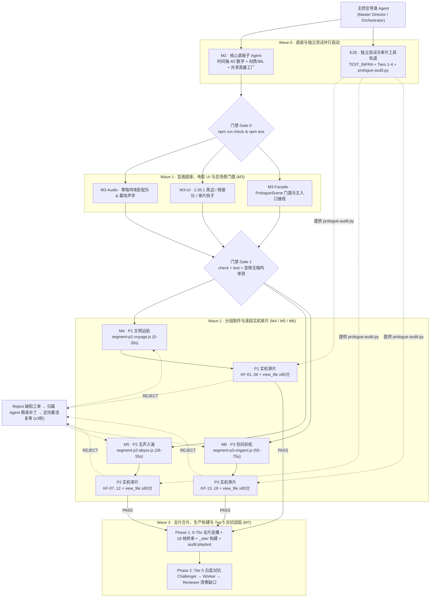

# 《维度之外 · Beyond 3D》序章《迷航》Agent 集群分段制作与实机审片执行规范

> **文档角色**：主控总导演 Agent（Master Director Agent）调度专业子 Agent 集群（Sub-Agent Cluster）的权威工程执行手册  
> **设计依据**：[`docs/design/prologue-spec-v1.md`](prologue-spec-v1.md)（v1.1 深化版）、[`docs/design/quality-spec-v1.md`](quality-spec-v1.md)（试玩版第 14 关品质锚点）及项目总蓝图 `PROJECT.md`  
> **核心工作流**：**契约先行 → 模块解耦与排他文件所有权 → 分段拆解（`P1 / P2 / P3`）→ 并行生成 → 逐段无头 Playwright Chromium 实机渲染审片 → 缺陷工单定向回炉闭环 → 全片合片与回归放行**  
> **目标水准**：100% 离线零打包原生 ESM + Babylon.js `9.37.2` + 程序化 Web Audio；每段多模态实机视觉审片得分 **$\ge 85 / 100$**（全面超越试玩版第 14 关）、**0 项红线违规**、**0 控制台/页面报错**。

---

## 一、Agent 集群角色拓扑与执行 DAG

主控总导演 Agent 不直接手写全部业务实现，而是通过**波次推进（Wave-Based Execution）**与**排他性文件边界**调度专业化子 Agent 集群，并在每个分段（`P1`、`P2`、`P3`）强制卡控「真实 Chromium 渲染截屏 + `view_file` 多模态视觉审片」门禁。



### 1.1 集群角色职责表
| 集群角色 / 里程碑 | 所属波次 | 核心职责 | 上游依赖 |
| :--- | :---: | :--- | :--- |
| **主控总导演 Agent** | 全波次 | 派发任务、校核接口契约、执行分段实机审片裁决、签发缺陷工单、管理全片最终合片放行 | — |
| **M1 · 规格书作者** | 前置（已完成） | 深化 `docs/design/prologue-spec-v1.md`（v1.1）并编制本集群执行手册 | — |
| **E2E · 独立黑盒测试与审片工具 Agent** | Wave 0（并行） | 编制 `TEST_INFRA.md`、`tests/e2e/prologue-tier{1..4}-*.test.mjs`、`scripts/prologue-audit.py`（18 帧 Playwright+Pillow 自动化审核器）、`scripts/run-prologue-e2e.mjs` 与 `TEST_READY.md` | 仅依赖规格与契约（黑盒隔离） |
| **M2 · 核心时间轴、材质库与共享英雄资产 Agent** | Wave 0 | 实现纯核心 75s 时间轴与 4D 数学、3 套 6 面 IBL + `>= 14` PBR/Shader 材质库、跨镜头 100% 一致的旗舰/科研舱/林夏/08 号冬眠舱工厂、核心单测 | M1 |
| **M3 · 音画底座、电影 UI 与总门面 Agent 组** | Wave 1 | 实现零嗡鸣电影配乐与「墓地」非人类声学引擎、角色声线扩展、输入拖拽锁、2.35:1 电影 HUD 与 48 柱量子频谱仪、`PrologueScene` 门面与 `?audit=1`/`seekPrologue` 接线、音频单测 | M2 |
| **M4 · 分段 P1 视觉制作 Agent** | Wave 2 | 实现第一段《文明远航》（`0–26s`: `S0A, S0B-1, S0B-2, S0C`）并通关 `KF-01..KF-06` 实机视觉审片 | M3, `scripts/prologue-audit.py` |
| **M5 · 分段 P2 视觉制作 Agent** | Wave 2 | 实现第二段《无声入海》（`26–55s`: `S1, S2, S3`）并通关 `KF-07..KF-12` 实机视觉审片 | M3, `scripts/prologue-audit.py` |
| **M6 · 分段 P3 视觉制作 Agent** | Wave 2 | 实现第三段《空间折纸》（`55–75s`: `S4-1, S4-2, S5, S6`）并通关 `KF-13..KF-18` 实机视觉审片 | M3, `scripts/prologue-audit.py` |
| **M7 · 全片集成、实机回归与 Tier 5 对抗加固组** | Wave 3 | 全片 0–75s 连播与过渡抽检、`_site/` 静态构建验证、`npm run audit:playtest`（L0+L1–L4+L14）回归，随后启动 Tier 5 白盒对抗 Challenger→Worker→Reviewer 循环直至 0 缺口 | M4, M5, M6, `TEST_READY.md` |

---

## 二、排他性文件所有权矩阵（Exclusive File Ownership Matrix）

为杜绝并行子 Agent 合并冲突，**任何文件在任一里程碑仅允许唯一归属者写入**（与 `PROJECT.md` Code Layout 100% 逐路径一致）：

| 仓库精确路径 | 唯一写入归属 | 操作类型 | 核心职责边界 |
| :--- | :---: | :---: | :--- |
| `docs/design/prologue-spec-v1.md` | **M1** | 深化更新 | 序章 v1.1 电影制作规格书 |
| `docs/design/prologue-agent-cluster-execution-spec.md` | **M1** | 新建 | 本文档：Agent 集群分段执行与审片规范 |
| `docs/design/quality-spec-v1.md` | 只读参考 | 禁止改动 | 第 14 关基准参考（L63 已被本序章零嗡鸣口径覆盖） |
| `src/core/prologue-timeline.js` | **M2** | 新建 | 纯核心 75s 时间轴、Cue 表、18 帧清单、4D 数学（严禁出现任何 DOM/引擎词） |
| `src/core/tesseract-boundary.js` | **M2** | 最小升级 | `PrologueVoyagerState` 代理至 `prologue-timeline.js`，保持向后兼容 |
| `src/engine/prologue-materials.js` | **M2** | 新建 | 3 套 6 面 IBL、`>= 14` PBR/Shader 材质库、Ghost 断言器、后处理管线 |
| `src/levels/prologue/prologue-shared.js` | **M2** | 新建 | 跨镜共享英雄工厂：旗舰「远航者号」、护航舰、科研舱核心、林夏、08 号冬眠舱、样条工具 |
| `tests/prologue-timeline.test.mjs` | **M2** | 新建 | 时间轴、Cue 序列、4D 数学、序章红线纯核心单元测试 |
| `tests/chapter1-boundary.test.mjs` | **M2** | 兼容验证 | 确保既有 25 项测试零回归（保持 `voiceTriggered` 在 `<= 6.8s` 触发） |
| `src/engine/prologue-audio.js` | **M3** | 新建 | 零嗡鸣电影配乐、墓地非人类三层声学引擎、无头 48 柱解析频谱回退 |
| `src/engine/character-voice.js` | **M3** | 最小升级 | 新增 `narrator`、`broadcast`、`ship_ai`、`tomb_signal (skipSpeechSynthesis: true)` |
| `src/engine/input-controller.js` | **M3** | 最小升级 | 在 `'prologue'` 模式下屏蔽鼠标拖拽对 `yaw/pitch` 的修改 |
| `src/levels/prologue-scene.js` | **M3** | 新建 | `PrologueScene` 门面：相机/灯光/阴影/镜面/后处理/EXP2 雾/三段调度/`seekToState`/遥测 |
| `src/levels/chapter1-levels.js` | **M3** | 最小升级 | 移除旧版单舱 `PrologueScene`，改为 `export { PrologueScene } from './prologue-scene.js'` |
| `src/ui/prologue-overlay.js` | **M3** | 新建 | `PrologueOverlayController`：2.35:1 黑边、S0A/S0C 卡片、S3 48 柱频谱仪、字幕、白幕 |
| `src/ui/index.html` / `src/ui/styles.css` / `src/ui/hud.js` | **M3** | 最小升级 | 挂载 `#prologue-cinema-layer`、2.35:1 影院样式、第 0 关 HUD 代理 |
| `src/ui/main.js` | **M3** | 最小升级 | L0 禁调 `sfx.startStationAmbience()`、接入音频/HUD 控制器、`maxZ=1200`、`?audit=1` 与 `seekPrologue` |
| `tests/prologue-audio.test.mjs` | **M3** | 新建 | Mock `AudioContext` 单元测试：零低频嗡鸣、零墓地 TTS、销毁零泄漏 |
| `src/levels/prologue/segment-p1-voyage.js` | **M4** | 新建 | 第一段 P1《文明远航》（`0–26s`: `S0A, S0B-1, S0B-2, S0C`） |
| `src/levels/prologue/segment-p2-abyss.js` | **M5** | 新建 | 第二段 P2《无声入海》（`26–55s`: `S1, S2, S3`） |
| `src/levels/prologue/segment-p3-origami.js` | **M6** | 新建 | 第三段 P3《空间折纸》（`55–75s`: `S4-1, S4-2, S5, S6`） |
| `TEST_INFRA.md` / `TEST_READY.md` | **E2E 轨道** | 新建 | 独立黑盒 E2E 基础设施与就绪报告 |
| `tests/e2e/prologue-tier{1..4}-*.test.mjs` | **E2E 轨道** | 新建 | 4 层黑盒 E2E 自动化测试（功能/边界/组合/场景） |
| `scripts/prologue-audit.py` | **E2E 轨道** | 新建 | 自托管 ephemeral `serve.mjs` + 18 帧 Playwright + Pillow 13.0 + DOM/红线审核器 |
| `scripts/run-prologue-e2e.mjs` | **E2E 轨道** | 新建 | Tiers 1–4 统一执行入口 |
| `scripts/playtest-audit.py` | **M7** | 回归核验 | 仅在确需同步序章步长时做最小校准；保障 L0 + L1–L4 + L14 全绿 |

---

## 三、跨模块强类型接口契约（Contracts A – F · 与 `PROJECT.md` 逐字对齐）

所有子 Agent 必须严格按下列签名编码，严禁私自改名、增删必填返回值字段或跨越文件所有权。

### Contract A：纯核心时间轴（`src/core/prologue-timeline.js` ↔ 全部消费者）
- **纯核心隔离**：全文件（含注释）严禁出现 `src/core/` 禁用词（详见第四章）。
- **必含具名导出**：
  - `PROLOGUE_TOTAL_DURATION_SEC = 75.0`
  - `PROLOGUE_SEGMENTS`：`[{ id: 'P1', name: '文明远航', startSec: 0, endSec: 26, shots: ['S0A','S0B','S0C'] }, { id: 'P2', name: '无声入海', startSec: 26, endSec: 55, shots: ['S1','S2','S3'] }, { id: 'P3', name: '空间折纸', startSec: 55, endSec: 75, shots: ['S4','S5','S6'] }]`
  - `PROLOGUE_SHOTS`：完整覆盖 `[0, 75]`、无间隙无重叠的有序镜头表（`S0A [0,11]`, `S0B [11,22]` 含 `S0B-1 [11,15]` & `S0B-2 [15,22]`, `S0C [22,26]`, `S1 [26,35]`, `S2 [35,44]`, `S3 [44,55]`, `S4 [55,64]` 含 `S4-1 [55,61]` & `S4-2 [61,64]`, `S5 [64,71]`, `S6 [71,75]`）
  - `PROLOGUE_CUES`：不可变事件数组 `{ id, atSec, endSec, shotId, segmentId, kind: 'voice'|'music'|'sfx'|'card'|'spectrometer', speaker?, text?, meta? }`（零禁用词、零墓地 TTS、零 S6 对白）
  - `PROLOGUE_KEYFRAMES`：18 帧权威审片清单 `KF-01..KF-18`
  - 4D 纯数学函数：`computeRecursiveTesseract4D(timeSec)`、`computeSealedBoxOrb4D(localT)`、`computeBridgeOrigamiAngles(localT)`
  - `evaluatePrologueAt(tSec)` → 纯不可变帧快照对象：
    ```js
    {
      elapsedSec, totalDurationSec: 75.0, segmentId, shotId, subBeatId, shotProgress, segmentProgress,
      camera: { pos: [x,y,z], target: [x,y,z], fov, roll, shake },
      post: { exposure, contrast, bloomWeight, bloomThreshold, vignetteWeight, grainIntensity, whiteoutAlpha },
      fog: { colorHex, density, clearColorHex },
      iblPreset: 'IBL_DEEP_SPACE' | 'IBL_CRYO_CABIN' | 'IBL_POLAR_DAY',
      iblIntensity,
      letterboxRatio,          // [0, 71.5] 为 1.0，[71.5, 74.8] 平滑过渡 1.0 -> 0.0
      openingLinesAlpha: [a0, a1, a2],
      openingLinesText: [line1, line2, line3],
      coordCardAlpha,
      coordCardLines: [line1, line2],
      alertLevel,              // 0..1，S2 完整没入光幕 +2.0s 后启动冷静琥珀频闪
      starExtinctionProgress,  // 0..1（S3）
      spectrometer: { active, alpha, progress, parsePct, text, energy, bars: number[] /* length 48 */ },
      orbExcursion4D: { pos3: [x,y,z], w, sliceHaloAlpha, glowIntensity },
      xrayWaveProgress,        // 0..1（S4-1）
      shatterProgress,         // 0..1（S4-1）
      cryoWakeupProgress,      // 0..1（S4-2）
      origamiFoldProgress,     // 0..1（S5）
      activeSubtitle: { speakerId, speakerLabel, text, color, alpha } | null,
      activeCues: []
    }
    ```
  - `class PrologueDirectorState`（由 `src/core/tesseract-boundary.js` 中 `PrologueVoyagerState` 继承/代理）：保留向后兼容字段 `levelId = 0`, `elapsedSec`, `totalDurationSec = 75.0`, `completed`, `skipped`, `beat`, `voiceTriggered`（于 `t >= 0.8s` 置 `true` 确保旧测试 `p.update(7.0)` 通过）；实现 `reset()`, `update(dtSec)`, `seek(tSec)`, `skip()`, `getSnapshot()`。

### Contract B：材质、IBL 与后处理管线（`src/engine/prologue-materials.js` ↔ 共享工厂、分段与门面）
- `createPrologueIBLSet(scene)` → `{ IBL_DEEP_SPACE, IBL_CRYO_CABIN, IBL_POLAR_DAY, dispose() }`（6 面 `RawCubeTexture`，严禁旧版绯红底色）。
- `createPrologueMaterialBank(scene)` → 返回 $\ge 14$ 种具名 PBR/Shader 材质（`hullTitanium`, `hullDarkRib`, `hullAccentGold`, `warpPlasmaCore`, `cryoAlloy`, `cryoFrostedGlass`, `cabinDeckMirror`, `cabinDarkTitanium`, `deskWoodBronze`, `linXiaSuitPBR`, `borosilicateGlass`, `calibrationSphereCrystal`, `mercuryVeilShader`, `tesseractCyanBeam`, `tesseractGoldBeam`, `xrayCutawayGhost`, `glassShardLuminous`, `origamiHingeGlow`, `volumetricShaft`）及 `verifyGhostInvariants()`（返回 `{ ok, violations }`，校验所有 `alpha < 0.99` 材质均满足 `disableDepthWrite === true` 且 `needDepthPrePass === false`）。
- `setupPrologueCinemaPipeline(scene, camera)` → 返回命名 `prologue_cinema_pipeline` 的 `DefaultRenderingPipeline` 及 `applyCinemaGrading(pipeline, postSpec)`。

### Contract C：跨镜头共享英雄资产工厂（`src/levels/prologue/prologue-shared.js` ↔ P1, P2, P3）
为保证跨切镜头的旗舰、科研舱、07 号林夏与 `08 号` 冬眠舱 **100% 造型、材质与比例一致**，严禁各分段自行重复拼装英雄资产，必须统一调用：
- `createFlagshipVoyager(scene, materials, namePrefix)` → `{ root, warpRings, navLights, bowGlass, setWarpPower(p), setAlertLevel(a), dispose() }`
- `createEscortVessel(scene, materials, namePrefix, scale)` → 护航舰多部件实体
- `createScienceCabinCore(scene, materials, namePrefix, { registerShadowCaster, registerMirrorMesh })` → `{ root, deskRoot, bowWindowMesh, linXiaRig, pod08Rig, statusLights, mirrorFloor, setAlertLevel(a), setLinXiaPose(pose), setPod08State(state), dispose() }`
- 数学与样条助手：`evalCatmullRom3(points, u)`、`easeInOutCubic`、`easeOutExpo`、`easeInQuart`、`smoothstep`。

### Contract D：视觉分段接口（`segment-p{1,2,3}-*.js` ↔ `src/levels/prologue-scene.js`）
每个分段模块导出唯一类（`SegmentP1Voyage` / `SegmentP2Abyss` / `SegmentP3Origami`），实现完全一致的生命周期接口：
```js
export class SegmentP1Voyage /* | SegmentP2Abyss | SegmentP3Origami */ {
  constructor(scene, materials, sharedRig) {}
  // sharedRig = { root, shadowGenerator, mirrorRenderList, registerShadowCaster(mesh), registerMirrorMesh(mesh) }
  setActive(active) {}
  evaluate(snapshot, dtSec) {}      // 100% 仅依据 snapshot.elapsedSec 驱动网格、着色器、粒子与局部光源
  prewarmParticles(ticks) {}        // 确定性粒子预热（供 seekPrologue 使用，不推进 state.elapsedSec）
  getDiagnostics() {}               // { segmentId, active, meshCount, activeHeroes: string[], particleSystems: number }
  dispose() {}
}
```
主场景门面 `PrologueScene`（`src/levels/prologue-scene.js`，由 `src/levels/chapter1-levels.js` 重导出）：
- `constructor(scene, camera)`：配置 3 个渲染组（`configureRenderingGroups`）、`camera.minZ = 0.08`、`camera.maxZ = 1200`、3 套 IBL、`DefaultRenderingPipeline`、`FOGMODE_EXP2`、三点布光、PCF `ShadowGenerator(1024)`、舱内 `MirrorTexture(512)`（仅舱内镜启用），并实例化 P1/P2/P3。
- `syncFromState(state, input, dtSec)`：**100% 忽略 `input.yaw`/`input.pitch`**，仅依据 `state.getSnapshot()` 切换活跃段（含过渡缓冲容差）、更新相机/IBL/灯光/EXP2 雾/后处理。
- `seekToState(state, { warmupTicks = 18 } = {})`：确定性跳转并调用活跃段 `prewarmParticles(warmupTicks)` + `evaluate`。
- `getPrologueDiagnostics()`：返回与 `getPrologueTelemetry()` 对齐的场景遥测。
- `dispose()`：零泄漏释放全部 3 段、材质、IBL、管线、阴影器与镜面纹理。

### Contract E：零嗡鸣音频与语音（`src/engine/prologue-audio.js` & `src/engine/character-voice.js` ↔ `src/ui/main.js`）
- `CharacterVoiceEngine`（`src/engine/character-voice.js`）新增声线配置：`narrator`（`旁白`, `#E8EFF8`）、`broadcast`（`舰桥广播`, `#A5FCF2`）、`ship_ai`（`远航者号 · 舰载系统`, `#F7C346`）、`tomb_signal`（`舰载量子频谱仪`, `#4DE6D3`, **`skipSpeechSynthesis: true`**）。
- `PrologueAudioDirector(sfxEngine, voiceEngine, { audioContextFactory? })`：
  - `handleFiredCues(firedCues, snapshot)`：驱动钢琴、温暖拉弦大提琴、竖琴、水晶跃迁滑音、冬眠锁止、冷静科研双音提示、**墓地非人类三层声学引擎**、4D 相位滑移、碎晶风铃、折纸咬合 + 竖琴滑音，以及含 `-6 dB` 闪避的旁白/台词（**绝不对墓地调用 `speechSynthesis`**）。
  - `update(snapshot, dtSec)`：平滑包络调制，**绝无低频船体巡航嗡鸣**（`shipHumActive: false`）。
  - `getSpectrometerBars(barCount = 48, snapshot)`：音频已解锁时融合实时 `AnalyserNode`，无头/挂起状态下回退确定性解析脉冲星+巨鲸双峰频谱。
  - `getTelemetry()` → `{ audioMode: 'prologue_cinema', shipHumActive: false, stationAmbienceActive: false, tombTtsCount: 0, activeOscillators, firedAudioCues }`。
  - `setPaused(paused)`、`stopAll()`、`dispose()`。
- **既有引擎联动**：`src/ui/main.js` 在 `levelId === 0` 时**严禁**调用 `src/engine/sound-fx.js` 中的 `startStationAmbience()` 或 `startSanctuaryAmbience()`。

### Contract F：电影 HUD 与确定性审片钩子（`src/ui/prologue-overlay.js` & `src/ui/main.js` ↔ `scripts/prologue-audit.py`）
- `PrologueOverlayController` 独家管理 `#prologue-cinema-layer`（仅在 `body.is-prologue` 显示），所有黑边高度、文字透明度、48 柱量子频谱仪 Canvas 与白幕完全由 `snapshot` 同步（零墙钟漂移）。
- 支持 URL 审片查询参数（当 `level=0`）：
  - `?level=0&audit=1`：启动时禁止自动 `engine.runRenderLoop()`（消除 `+0.200s` 启动漂移）。
  - `?level=0&audit=1&t=50.5` 或 `&shot=S3`：确定性停驻目标时刻或镜头中点。
  - `?level=0&holdEnd=1`：停驻 `t = 75.0s` 不自动离开序章（便于 `S6` 尾帧检查）。
- `window.__BEYOND3D__.actions` 扩展（当 `levelId === 0`）：
  - `seekPrologue(tSec, { warmupTicks = 18 } = {})` → 执行 `state.seek(tSec)` → `scene3D.seekToState(state, { warmupTicks })` → `overlay.sync(snapshot)` → `scene.render()`。
  - `getPrologueTelemetry()` → `{ elapsedSec, shotId, subBeatId, segmentId, shotProgress, letterboxRatio, activeSubtitle, openingLinesAlpha, coordCardAlpha, spectrometerVisible, spectrometerBars, spectrometerText, skipBtnVisible, activeMeshCount, pbrCount, envTex, fogMode, particles, postProcs, shadowGens, mirrorTex, ghostViolations, audioMode, stationAmbienceActive, shipHumActive, tombTtsCount }`。
- `Space` 跳过与尾镜交接：防抖 `!e.repeat`，静音清理后置 `state.skip()`、拉起 `450ms` 纯白溶出层并在 `< 0.05s` 内调用解耦回调 `onPrologueComplete({ skipped, exitColor: '#FFFFFF', transitionMs: 450 })`（`main.js` 当前映射至 `loadLevel(1)` 以兼容 `scripts/playtest-audit.py`）。

---

## 四、仓库工具链与静态陷阱防踩坑清单（必读）

每个子 Agent 在动手编码前必须逐条核查以下经本仓库实测确认的硬性陷阱：

| # | 陷阱类别 | 仓库实测事实与风险 | 强制规避措施 |
|---:|---|---|---|
| **T-01** | **真实引擎文件名** | 仓库实际音频与语音模块路径为 **`src/engine/sound-fx.js`** 与 **`src/engine/character-voice.js`**；新序章音频模块建于 `src/engine/prologue-audio.js`。 | 一律导入真实文件路径，严禁拼错路径导致浏览器 404。 |
| **T-02** | **`scripts/check.mjs` 纯核心注释扫描陷阱** | `scripts/check.mjs:38` 对 `src/core/*` **原始全文（含注释与 JSDoc！）**运行 `/\b(document\|window\|BABYLON)\b/` 正则。哪怕在注释里写「本文件不使用上述全局对象」只要出现这三个英文词就会直接报错失败！ | 在 `src/core/` 下所有文件（包括代码、字符串与注释）**绝对禁止**出现那 3 个英文单词，改用中文「浏览器环境」「三维引擎」表述。 |
| **T-03** | **`scripts/check.mjs` 深度预通道注释扫描陷阱** | `scripts/check.mjs:46` 对 `src/*` **原始全文（含注释！）**运行 `/needDepthPrePass\s*(?::\|=)(?!=)\s*true/` 正则。哪怕在注释中写反例示范也会触发 `Render invariant violation`！ | 在 `src/` 下任何文件（含注释）永远只写 `needDepthPrePass = false` 或 `needDepthPrePass: false`，严禁在注释中拼出将它设为真的示例语法。 |
| **T-04** | **`npm test` 单层文件匹配** | `package.json:8` 为 `"test": "node --test tests/*.test.mjs"`（非递归）。 | 常规单元测试放在 `tests/prologue-timeline.test.mjs`、`tests/prologue-audio.test.mjs`；独立黑盒 E2E 套件放在 `tests/e2e/` 并通过 `node scripts/run-prologue-e2e.mjs` 执行，防止未就绪期间阻断中间 `npm test`。 |
| **T-05** | **`scripts/serve.mjs` 的 `PORT=0` 陷阱** | `scripts/serve.mjs:12` 使用 `Number(process.env.PORT \|\| 4173)`，传入 `PORT=0` 会因 falsy 回退到冲突端口 `4173`。 | `scripts/prologue-audit.py` 必须先用 Python `socket.bind(("127.0.0.1", 0))` 获取空闲端口，再以 `HOST=127.0.0.1 PORT=<free>` 启动 `scripts/serve.mjs` 并在 `finally:` 中终止。 |
| **T-06** | **宇宙级远裁剪 `maxZ`** | `src/ui/main.js:343` 旧版将 `camera.maxZ` 设为 `140`，会导致 `S3` 位于 `Z = +320m` 的递归正八胞体巨构完全被裁剪消失。 | 序章场景与主入口在 `levelId === 0` 时强制锁定 `camera.minZ = 0.08`、`camera.maxZ = 1200`。 |
| **T-07** | **SwiftShader 渲染耗时预算** | 无头 Chromium 使用 CPU SwiftShader，单帧 `1280×720` CDP 截屏约需 `~11.0s`，页面首次着色器编译约需 `~6.3s`。 | 审核脚本必须**复用单个页面**（`?level=0&audit=1` + `seekPrologue(tSec)`），避免每帧重启浏览器；各分段必须 `setActive(false)` 停用非激活子树、使用 Thin Instances 控管 Draw Calls `< 120`、仅在舱内镜启用 `MirrorTexture(512)`。 |
| **T-08** | **`scripts/playtest-audit.py` 既有门禁** | 强制校验 `pbrCount >= 4`（本序章目标 `>= 10`，每单段 `>= 4`）、`envTex === true`、`postProcs.length >= 1`、`particles >= 1`、`fogMode === 2`、`Space` 跳过在 `2 × 0.05s = 0.10s` 内将 `levelId` 切至 `1`，且第 1 关保留原 GDD 校验。 | 严格遵守 Contract F 的 `< 0.05s` 跳过状态交接 + `450ms` 纯白溶出；红线扫描器严格限定序章作用域，不触碰旧版 Level 1。 |

---

## 五、分段构建与独立验收协议（`P1` → `P2` → `P3`）

在 Wave 0（M2）与 Wave 1（M3）通过 `npm run check && npm test` 后，进入 Wave 2 分段制作与逐段实机视觉审核。各分段既可由 M4/M5/M6 并行编码，**也必须按段逐一完成实机截屏审片并通过 $\ge 85/100$ 才允许合入 Wave 3**：

### 5.1 第一段：`P1 · 文明远航`（`0.0s – 26.0s`，归属 M4）
- **开发文件**：`src/levels/prologue/segment-p1-voyage.js`
- **镜头范围**：`S0A (0–11s)`、`S0B-1 (11–15s)`、`S0B-2 (15–22s)`、`S0C (22–26s)`
- **复用资产**：通过 `prologue-shared.js` 实例化旗舰「远航者号」、4 艘护航舰与 `08 号` 冬眠舱规格，确保与 P2/P3 外观 100% 统一。
- **独立实机审片命令**：
  ```bash
  npm run check && npm test
  python3 scripts/prologue-audit.py --segment P1 --out-dir _site/prologue_audit/p1
  ```
- **完成定义（DoD）**：`KF-01..KF-06` 全部自动化像素/遥测/红线断言 100% 通过，且总导演 Agent 通过 `view_file` 逐帧核查全部 6 张 PNG，评分 **$\ge 85 / 100$**。

### 5.2 第二段：`P2 · 无声入海`（`26.0s – 55.0s`，归属 M5）
- **开发文件**：`src/levels/prologue/segment-p2-abyss.js`
- **镜头范围**：`S1 (26–35s)`、`S2 (35–44s)`、`S3 (44–55s)`
- **关键核查**：`S1` 暖琥珀台灯与幽蓝 `08 号` 冬眠区高对比度 + 实时镜面甲板 + PCF 软阴影；`S2` 液态水银四维光幕不遮挡背后旗舰（Ghost 铁律）且整舰完全没入 `+2.0s`（`40.6s`）后才亮冷静琥珀预警；`S3` 600 颗星辰逐颗熄灭 + 宇宙级 3 层 `rotPlane4` 递归正八胞体巨构压迫微缩旗舰 + 48 柱量子频谱仪活跃跳动与 `14%` 残缺破译可读。
- **独立实机审片命令**：
  ```bash
  npm run check && npm test
  python3 scripts/prologue-audit.py --segment P2 --out-dir _site/prologue_audit/p2
  ```
- **完成定义（DoD）**：`KF-07..KF-12` 自动化全绿 + `view_file` 逐帧视觉审片 **$\ge 85 / 100$**。

### 5.3 第三段：`P3 · 空间折纸`（`55.0s – 75.0s`，归属 M6）
- **开发文件**：`src/levels/prologue/segment-p3-origami.js`
- **镜头范围**：`S4-1 (55–61s)`、`S4-2 (61–64s)`、`S5 (64–71s)`、`S6 (71–75s)`
- **关键核查**：`S4-1` 六面完全密封高硼硅盒盖与玻璃完好闭合而校准球已穿壁漂浮于盒外 + 苍青 X-Ray 透视显露内部结构肋 + 弧形玻璃青金正交裂纹碎为 200 片无失压悬浮碎晶；`S4-2` 甩镜至紧急翡翠绿 `08 号` 冬眠舱滑开、寒雾散去进入第一人称 POV；`S5` 上下左右深钛舱壁沿青金铰链精确 `±90°` 折纸展开；`S6` 极昼纯白几何光浪吞没画面、黑边平滑退场、零台词、零旧版第一章元素。
- **独立实机审片命令**：
  ```bash
  npm run check && npm test
  python3 scripts/prologue-audit.py --segment P3 --out-dir _site/prologue_audit/p3
  ```
- **完成定义（DoD）**：`KF-13..KF-18`（加检 `t = 74.6s` 黑边退场终点探针）自动化全绿 + `view_file` 逐帧视觉审片 **$\ge 85 / 100$**。

---

## 六、18 帧权威无头 Playwright 实机审片清单（`KF-01..KF-18`，`1280×720`）

`scripts/prologue-audit.py` 在 `1280×720` 无头 Chromium（SwiftShader ANGLE 参数：`--use-gl=angle --use-angle=swiftshader --enable-unsafe-swiftshader --ignore-gpu-blocklist`）下加载 `?level=0&audit=1&holdEnd=1`，通过单页循环调用 `window.__BEYOND3D__.actions.seekPrologue(tSec, { warmupTicks: 18 })` 采集以下全部 18 帧 PNG，并用 **Pillow `13.0.0`** 与遥测同步执行自动化硬门禁校验：

| 帧号 | 分段 | 精确 `tSec` | 所属镜头 | PNG 文件名 | 预期英雄视觉焦点 | 必检遥测断言（`getPrologueTelemetry`） | Pillow 13.0 像素与 DOM 断言（`1280×720`） |
| :---: | :---: | :---: | :---: | :--- | :--- | :--- | :--- |
| **`KF-01`** | P1 | `2.0s` | `S0A` | `kf01_p1_s0a_line1.png` | 纯黑冷白微星尘 + 居中第 1 行纤细字幕清晰、零游戏 HUD | `shotId==='S0A'`, `letterboxRatio===1`, `openingLinesAlpha[0]>=0.9`, `shipHumActive===false` | 上下黑边 `y∈[0,76]/[644,720]` 均值 `<12`；有效区均值 `<40` 且中央文字区峰值 `>180` |
| **`KF-02`** | P1 | `8.5s` | `S0A` | `kf02_p1_s0a_lines3.png` | 三行极简字幕和谐居中 + 底部旁白字幕清晰，与右下跳过胶囊零重叠 | `openingLinesAlpha.every(a=>a>=0.9)`, `activeSubtitle!==null` | 黑边 `<12`；字幕与跳过按钮 `DOMRect` 零交集；与 `KF-01` 帧间 `MAD > 6.0` |
| **`KF-03`** | P1 | `13.2s` | `S0B-1` | `kf03_p1_s0b1_cryo08.png` | 纵深冬眠长廊、PCF 软阴影、雾化舱罩降下、冰蓝生命灯、**`08 号`** 铭牌清晰 | `subBeatId==='S0B-1'`, `shadowGens>=1`, `pbrCount>=4`, `ghostViolations.length===0` | 黑边 `<12`；有效区 `y∈[92,628]` 均值 `>10` 且 `max(stddev)>14`；`MAD > 6.0` |
| **`KF-04`** | P1 | `17.5s` | `S0B-2` | `kf04_p1_s0b2_warp_ignite.png` | 旗舰「远航者号」+ 4 护航舰钛金高光、双曲率环与青金径向星流隧道爆发 | `subBeatId==='S0B-2'`, `particles>=2`, `envTex===true`, `postProcs.length>=1` | 黑边 `<12`；有效区均值 `>14`、`max(stddev)>18`（无死黑或白糊）；`MAD > 6.0` |
| **`KF-05`** | P1 | `20.8s` | `S0B-2` | `kf05_p1_s0b2_warp_peak.png` | 广角 FOV (`~76°`) 舰队化作流光冲入无垠深空，Bloom 干净不过曝 | `subBeatId==='S0B-2'`, `fogMode===2` | 黑边 `<12`；有效区均值 ∈ `[14, 210]` 且 `max(stddev)>18`；`MAD > 6.0` |
| **`KF-06`** | P1 | `24.0s` | `S0C` | `kf06_p1_s0c_coord47y.png` | 静谧深空荒漠 + 清晰宇航等宽坐标卡（`星舰纪元 47 年 · 距太阳系 412 光年`） | `shotId==='S0C'`, `coordCardAlpha>=0.9` | 黑边 `<12`；有效区暗底 `<48` 且中央坐标文字区峰值 `>185`；`MAD > 6.0` |
| **`KF-07`** | P2 | `30.5s` | `S1` | `kf07_p2_s1_linxia_cabin.png` | 弧形全景观测科研舱：实时镜面地板 + PCF 阴影 + 暖琥珀台灯与 07 号林夏 vs 幽蓝 `08 号 · 冬眠中` | `shotId==='S1'`, `mirrorTex>=1`, `shadowGens>=1`, `activeSubtitle.speakerId==='linxia'` | 黑边 `<12`；有效区均值 `>14`、`max(stddev)>16`；冷暖双色调清晰；`MAD > 6.0` |
| **`KF-08`** | P2 | `37.8s` | `S2` | `kf08_p2_s2_mercury_veil.png` | 舰首侧前外景：旗舰无察觉穿入透明液态水银四维光幕 + 船体截面银白同心波纹 | `shotId==='S2'`, `alertLevel===0`, `ghostViolations.length===0` | 黑边 `<12`；旗舰穿透透明水银幕依然完整可见（无深度预通道擦除）；`MAD > 6.0` |
| **`KF-09`** | P2 | `41.5s` | `S2` | `kf09_p2_s2_alert_2s.png` | 完整没入 `+2.0s` 后冷静琥珀预警频闪 + 舰载监测系统曲率异动警告字幕 | `shotId==='S2'`, `alertLevel>0.5`, `activeSubtitle.speakerId==='ship_ai'` | 黑边 `<12`；字幕与跳过胶囊零重叠；`MAD > 6.0` |
| **`KF-10`** | P2 | `46.5s` | `S3` | `kf10_p2_s3_stars_zero.png` | 跃迁流光凝固消散、600 颗恒星逐颗熄灭中、镜头极速后拉微缩旗舰 | `shotId==='S3'`, `starExtinctionProgress>0.4`, `tombTtsCount===0` | 黑边 `<12`；有效区均值 `>8`、`max(stddev)>14`；`MAD > 6.0` |
| **`KF-11`** | P2 | `50.5s` | `S3` | `kf11_p2_s3_megastructure.png` | 宇宙尺度震撼反差：下方孤立银白微尘旗舰 vs 苍青流金 3 层递归正八胞体巨构与体积光束 | `shotId==='S3'`, `starExtinctionProgress>=0.98`, `tombTtsCount===0` | 黑边 `<12`；巨构青金光棱清晰无远裁剪截断；有效区 `max(stddev)>16`；`MAD > 6.0` |
| **`KF-12`** | P2 | `53.2s` | `S3` | `kf12_p2_s3_spectrometer.png` | 底部无框透明 48 柱量子频谱仪活跃跳动 + `14%：……干涸……海……新的访客……` 清晰可读 | `spectrometerVisible===true`, `spectrometerBars.length===48`, `tombTtsCount===0` | `max(bars)-min(bars) > 0.15`；DOM 含 `14%`/`干涸`/`海`/`新的访客`；零重叠；`MAD > 6.0` |
| **`KF-13`** | P3 | `56.2s` | `S4-1` | `kf13_p3_s41_sealed_box.png` | 流星俯冲定焦科研台：六面完全密封透明高硼硅盒完好闭合，银蓝校准球已穿壁漂浮盒外 + 4D 光晕环 | `subBeatId==='S4-1'`, `ghostViolations.length===0`, `orbExcursion4D.sliceHaloAlpha>0.1` | 黑边 `<12`；有效区 `max(stddev)>16`；盒壁与盒外球体轮廓清晰；`MAD > 6.0` |
| **`KF-14`** | P3 | `58.0s` | `S4-1` | `kf14_p3_s41_xray_wave.png` | 苍青 4D 扫描波横扫科研舱：桌面与舱壁短暂半透明透视显露内部桁架与金色管线 | `subBeatId==='S4-1'`, `xrayWaveProgress>0.3`, `ghostViolations.length===0` | 黑边 `<12`；有效区 `max(stddev)>16`；无 Ghost 深度错误；`MAD > 6.0` |
| **`KF-15`** | P3 | `59.8s` | `S4-1` | `kf15_p3_s41_glass_shards.png` | 弧形全景玻璃呈现青金正交 4D 裂纹并碎为 200 片无失压悬浮发光几何碎晶 | `subBeatId==='S4-1'`, `shatterProgress>0.4`, `activeSubtitle.speakerId==='linxia'` | 黑边 `<12`；有效区 `max(stddev)>16`；碎晶层次丰富；`MAD > 6.0` |
| **`KF-16`** | P3 | `62.8s` | `S4-2` | `kf16_p3_s42_pod08_wake.png` | 甩镜至后侧紧急翡翠绿 `08 号` 冬眠舱滑开、寒雾散去无缝切入 08 号第一人称 POV | `subBeatId==='S4-2'`, `cryoWakeupProgress>0.4`, `particles>=2` | 黑边 `<12`；无舱框穿模遮死视野；有效区 `max(stddev)>14`；`MAD > 6.0` |
| **`KF-17`** | P3 | `67.8s` | `S5` | `kf17_p3_s5_origami90.png` | 08 号 POV：深钛地板/顶板/弧形舱壁沿青金发光 `90°` 铰链线折纸展开、融入极昼光芒与碎晶 | `shotId==='S5'`, `origamiFoldProgress>0.4`, `mirrorTex>=1` | 黑边 `<12`；有效区亮度显著攀升且 `max(stddev)>16`；无铰链接缝 Z-fighting；`MAD > 6.0` |
| **`KF-18`** | P3 | `73.5s` | `S6` | `kf18_p3_s6_polar_white.png` | 极昼纯白几何光浪柔和吞没视口、2.35:1 黑边退场中、**零台词、零旧版第一章元素** | `shotId==='S6'`, `activeSubtitle===null`, `letterboxRatio<0.6`（并在 `74.6s` 探针验证 `<0.1`） | 有效区高光纯白 `mean(RGB) > 215`；DOM 零台词；`74.6s` 探针上下边已退场（不再纯黑 `<12`） |

> **全帧通用自动化断言**：每帧必查 `consoleErrors.length === 0`、`pageErrors.length === 0`、HTTP `>= 400` 响应数 `=== 0`、标准游戏 HUD（`.hud-top-left`, `.hud-top-right`, `#reticle`, `#tactical-wrapper`, `#control-strip`, `#ch1-compass`）均不可见、全页面可见文本 0 命中红线禁词。

---

## 七、100 分制（锚定第 14 关基准）总导演多模态视觉评分量表

每段自动化脚本全部绿灯后，主控总导演 Agent（或指定视觉审片 Agent）**必须**调用 `view_file` 逐张检视该段全部 PNG，对照试玩版第 14 关（`?level=14`）的实机画面品质逐项打分。

### 7.1 硬性前置否决触发条件（Instant Reject Triggers — 出现任一项直接判 0 分打回）
1. 任意 `console` / `pageerror` / 404 资源错误，或 `pbrCount < 4` / `envTex !== true` / `fogMode !== 2` / `postProcs.length < 1` / `particles < 1` / `ghostViolations.length > 0`。
2. 任意一条红线 `FORBID-01`–`FORBID-06` 违规（包括任何音频/DOM/画面残留）。
3. 出现明显 3D 渲染硬伤：低模纯色火柴盒充当旗舰/林夏、穿模/穿窗、明显 Z-fighting 闪烁、透明材质深度错误擦除背景旗舰或校准球、黑屏/全灰死屏、字幕与跳过胶囊或频谱仪发生文字遮挡重叠。

### 7.2 100 分制五大维度评分标准
| 评分维度 | 满分 | 试玩版第 14 关锚点标尺（Benchmark） | 优秀（90–100%） | 合格（70–89%） | 不合格（<70% · 自动打回） |
| :--- | :---: | :--- | :--- | :--- | :--- |
| **1. 光影雕塑、对比度与 PBR 材质工艺** | **25 分** | 6 面 IBL、三点布光、PCF 软阴影、512 镜面地板、Sobel+ORM 质感，无平灰洗白 | 金属/玻璃高光锐利自然、暖琥珀 vs 冰蓝戏剧光比动人、Bloom 精准克制、全面超越 L14 | 管线齐全、层次清晰、达到 L14 同等质感，仅细节高光可微调 | 画面偏平灰发闷、塑料球感、高光过曝死白或缺乏阴影/镜面层次 |
| **2. 2.35:1 电影构图、镜头运动与尺度反差** | **20 分** | 焦点唯一、纵深导引强、视口清爽 85%+ | 三分法与透视引导极具大片感，`S0B-2`/`S3` 尺度震撼、`S4-1`/`S5` 镜头动线凌厉无裁切 | 主体清晰入画、2.35:1 安全区合规、跨镜衔接顺畅 | 主体被黑边切头截尾、`S3` 巨构远裁剪残缺或构图拥挤凌乱 |
| **3. 英雄资产与硬核四维 VFX 表现力** | **25 分** | 复合精雕建筑与道具、体积光束与多层微粒 | 旗舰/冬眠舱/林夏/密封盒精雕细琢；水银幕、递归八胞体、穿壁球、X-Ray、无失压碎晶与 90° 折纸一眼可读 | 全部 9 大核心资产与四维机制均正确清晰表达，无几何歧义 | 盒盖看起来开了或球未明显穿出、巨构过于单薄、折纸逻辑混乱 |
| **4. 电影字体、2.35:1 黑边与 UI 克制度** | **15 分** | 首帧零冗余遮挡、高可读光学美学 | 黑边比例精准、S0A/S0C 字体排版优雅高级、S3 无框 48 柱频谱仪极具硬科幻美感、跳过提示低调克制 | 排版整洁、可读性高、无重叠无遮挡 | 存在丑陋厚重卡片弹窗、字号拥挤、亮底白字看不清或偏离影院气质 |
| **5. 叙事忠实度与《死神永生》情绪还原** | **15 分** | 节奏克制留白、发现式情绪递进 | 完美传达流浪星舰文明的孤勇希望、静谧越界的诡谲、宇宙死寂的神圣敬畏与极昼留白余韵 | 100% 忠实 v1.1 分镜与台词，情绪转折准确 | 情绪跑偏成廉价恐怖/红警空难风格、因果顺序错乱或遗漏关键节拍 |

### 7.3 分段通过红线（PASS Bar）
分段审片 **同时满足以下三项** 方可签发 **PASS**：
1. **0 项硬性否决项触发**；
2. **总分 $\ge 85 / 100$**；
3. **5 大维度中没有任何单一维度得分低于该项满分的 $70\%$**（即分别不低于 `17.5 / 14 / 17.5 / 10.5 / 10.5`）。

---

## 八、自动化红线扫描器规格（`FORBID-01` – `FORBID-06`）

由独立 E2E 轨道在 `tests/e2e/` 与 `scripts/prologue-audit.py` 中实现**三层立体红线扫描器**（静态文件扫描 + Web Audio 模拟图/遥测扫描 + Playwright 实时 DOM 扫描），**严格限定序章作用域，绝不误伤未触动的旧版第 1 关**：

| 红线编号 | 静态扫描范围与正则规则（期望命中 = `0`） | 音频图 / 单元测试扫描 | Playwright 实机运行扫描 |
| :---: | :--- | :--- | :--- |
| **`FORBID-01`** | 扫描 `src/core/prologue*`、`src/levels/prologue*`、`src/engine/prologue*`、`src/ui/prologue*` 及 `src/ui/main.js` 序章分支：禁止匹配 `/隔到前面去了\|别跟丢了\|我先出舱看看\|EVA\s*·\s*07\|林夏已出舱/` | `PROLOGUE_CUES.filter(c => c.shotId === 'S6' && c.kind === 'voice').length === 0` | 全 18 帧 `document.body.innerText` 零命中；`KF-18 (73.5s)` `activeSubtitle === null` |
| **`FORBID-02`** | 扫描上述全部序章源码、数据表及序章测试输出（排除旧版第 1 关 `Level1CorridorScene` 与 `tiered-hints.js` L1 词条）：禁止匹配 `/红丝带\|redRibbon\|red_ribbon/i` | 序章字幕/标题/卡片全表 0 命中 | 全 18 帧 DOM 文本 0 命中 + 视觉审片 0 红丝带几何/贴图 |
| **`FORBID-03`** | 扫描上述全部序章源码与文案：禁止匹配 `/倒影慢半拍\|delayedReflection\|lagReflection/i` | — | 全 18 帧 DOM 文本 0 命中 + 镜面地板同步无滞后 |
| **`FORBID-04`** | 扫描 `src/ui/main.js` `levelId === 0` 分支与 `src/engine/prologue-audio.js`：严禁调用 `startStationAmbience` 或 `startSanctuaryAmbience` | `tests/prologue-audio.test.mjs` Mock `AudioContext` 断言：`S0A/S1/S2` 期间不存在持续 `> 2.5s` 且 `< 160Hz` 的静态机械嗡鸣/粉棕噪声源；`shipHumActive === false` | 全 18 帧遥测 `stationAmbienceActive === false && shipHumActive === false` |
| **`FORBID-05`** | 扫描 `src/engine/character-voice.js` 与 `src/engine/prologue-audio.js`：`tomb_signal` 必须硬设 `skipSpeechSynthesis: true` | 单元测试走完 `0–75s` 断言针对墓地调用 `speechSynthesis.speak` 次数严格 `=== 0` | 全 18 帧遥测 `tombTtsCount === 0`；`KF-12` 频谱仪可见且 `max(bars)-min(bars) > 0.15` |
| **`FORBID-06`** | 扫描全仓 `src/`、`scripts/`、`tests/`：严禁任何对 `migration/chapter1-4d-space` 的 `import`；扫描序章全部模块：严禁出现 `进入第 1 关`、`回廊`、`Level1CorridorScene` | `tests/prologue-timeline.test.mjs` 断言序章文案与跳过提示 0 绑定旧版第一章 | `KF-18 (73.5s)` 有效画幅 `mean(RGB) > 215`、DOM 零旧版第一章文案、场景零走廊网格 |

---

## 九、Reject → 定向缺陷工单 → 补丁 → 定向重渲 → 视觉复签闭环

任何分段在自动门禁或总导演 `view_file` 视觉审片中未达标（`< 85 分`、单项 `< 70%` 或命中任一否决项）时，严禁放任带病进入下一波次，必须严格执行以下回炉闭环：

### 9.1 标准化分段缺陷工单模板（Segment Defect Ticket）
```json
{
  "ticketId": "DEFECT-P2-01",
  "segmentId": "P2",
  "owningAgent": "M5 (src/levels/prologue/segment-p2-abyss.js)",
  "cycle": 1,
  "failedKeyframes": ["KF-08", "KF-11"],
  "pngPaths": [
    "_site/prologue_audit/p2/kf08_p2_s2_mercury_veil.png",
    "_site/prologue_audit/p2/kf11_p2_s3_megastructure.png"
  ],
  "scoreBreakdown": {
    "lightingPBR": 20,
    "framingScale": 12,
    "heroVFX": 16,
    "uiPolish": 14,
    "narrative": 13,
    "total": 75
  },
  "rootCauseCategory": "SHADER_GHOST_DEPTH | CAMERA_FRUSTUM | LIGHTING_CONTRAST | HERO_GEOMETRY | UI_SAFE_AREA | REDLINE",
  "diagnosis": "具体视觉与遥测根因描述（精确到材质键名、坐标、光源或 UI 像素盒）",
  "fixAcceptanceCriteria": [
    "可验证的定量与视觉修复判据 1",
    "可验证的定量与视觉修复判据 2"
  ]
}
```

### 9.2 四步精准回炉与 3 轮升级协议
1. **单点派发，零跨段爆炸半径**：主控总导演 Agent 仅将缺陷工单派发给单一归属文件责任 Agent（例如 `P2` 缺陷仅回派 M5，UI 重叠仅回派 M3-UI），严禁让非归属 Agent 跨界修改共享契约或其它分段。
2. **最小补丁 + 本地快检**：归属 Agent 按 `fixAcceptanceCriteria` 精准修复后，必须先通过 `npm run check && npm test` 验证零静态/核心回归。
3. **定向重渲 + 强制 `view_file` 复审**：重新运行 `python3 scripts/prologue-audit.py --segment <P1|P2|P3>` 刷新该段 PNG，总导演 Agent **必须再次用 `view_file` 亲自查验重渲 PNG** 并重新计分，严禁凭「口头宣称已修」放行。
4. **最大 3 轮迭代与架构升级（Escalation Protocol）**：若同一分段连续 3 轮回炉仍未达到 `>= 85 / 100`，主控总导演 Agent 必须暂停盲目微调，组织根因架构升级（例如重构共享工厂英雄几何、调整 IBL 动态范围或替换过重的片元着色器以兼顾 SwiftShader 精度），更新共享底座后再重跑受影响分段审片。

---

## 十、Wave 3 全片合片、生产构建与最终放行门禁（M7）

当 `P1`、`P2`、`P3` 全部获得分段 **PASS** 且 `TEST_READY.md` 公布后，主控总导演 Agent 启动最终里程碑 M7（双阶段放行）：

### Phase 1：全片连续验收、`_site/` 生产构建与全战役回归
按顺序执行并全部达到 100% 绿灯：
1. **静态语法与纯核心/Ghost 铁律全检**：
   ```bash
   npm run check
   ```
2. **全量核心与音频单元测试（含既有 25 项 + 新增序章单测）**：
   ```bash
   npm test
   ```
3. **独立黑盒 E2E Tiers 1–4 套件全绿**：
   ```bash
   node scripts/run-prologue-e2e.mjs
   ```
4. **生产静态站构建与零 `migration/` 污染校验**：
   ```bash
   npm run build:site
   ```
5. **基于生产构建 `_site/` 的全片 18 帧终审 + 0–75s 连续步进扫屏 + `Space` 跳过/重播防泄漏验证**：
   ```bash
   python3 scripts/prologue-audit.py --segment all --built-site --out-dir _site/prologue_audit/final
   ```
   - 主控总导演 Agent 通过 `view_file` 对最终合片 18 帧与跨段衔接帧（`25.8s / 26.2s`、`54.8s / 55.2s`）做最终视觉签字，确认与第 14 关同屏对比品质全面胜出。
6. **全战役既有关卡实机回归（序章 L0 + 第 1–4 关 + 第 14 关基准）**：
   ```bash
   npm run audit:playtest
   ```

### Phase 2：Tier 5 白盒对抗加固（Adversarial Hardening Loop）
Phase 1 100% 绿灯后，执行最终白盒对抗循环：
- 调度白盒对抗审计员（Challenger）针对完整序章源码、着色器、音频图、边界竞态（如切屏 `Esc` + 连按 `Space`、极窄/超宽视口、快速反复重播、`AudioContext` 解锁中途跳过、大 `dtSec` 跳帧）编写并运行对抗性破坏测试；
- 若发现任何边界缺陷或隐性泄漏，立即由 Worker 定向修复并经独立 Reviewer 复核 + 全量复跑 Phase 1 门禁，直至达到 **0 剩余缺陷**，正式签发《序章〈迷航〉电影级交付放行报告》。
