# 《维度之外 · Beyond 3D》序章《迷航》电影级制作规格书（v1.1 深化版）

> **文档角色**：总设计师 & 总导演权威工程制作规格书（Authoritative Cinema Production Specification）  
> **版本状态**：**v1.1 工程锁定版（深化定稿）** — 基于 v1.0 初定稿全面补齐 10 大工程与视听技术维度，可直接交付 Agent 集群与开发管线执行  
> **影片形态**：纯电影级实时 3D 过场演出（2.35:1 宽银幕电影黑边、全自动样条运镜、无需玩家操作、支持任意时刻按 `Space` 平滑跳过）  
> **精确总时长**：**`75.00s`**（三幕分段 `P1 / P2 / P3`，9 个主镜 `S0A–S6`，11 个细分子节拍）  
> **品质基线**：严格遵守并全面超越 [`docs/design/quality-spec-v1.md`](quality-spec-v1.md) 试玩版第 14 关基准（6 面程序化 IBL、ACES/Bloom/FXAA/Sharpen/Vignette/Grain、`FOGMODE_EXP2`、三点布光 + PCF 软阴影 + 舱内实时物理镜面反射 + 多层 GPU 粒子 + Ghost 材质深度铁律）  
> **音频口径覆盖声明**：本规格书第七章（零低频嗡鸣电影音景与「墓地」非人类高维声学设计）代表最终拍板口径，**正式覆盖并取代** `docs/design/quality-spec-v1.md` 第 63 行关于序章旧版低频脉冲的历史表述。  
> **与旧版第一章的完全解耦说明**：本序章在代码模块、3D 场景几何、文案字幕、UI 按钮与尾镜画面上**完全独立于旧版第一章**，严禁引入旧版第一章或待迁入目录的资产依赖；尾镜 `S6` 以极昼纯白几何光浪留白收束并通过解耦回调 `onPrologueComplete` 交接给外层路由。  
> **配套执行手册**：Agent 集群分段开发、18 帧实机审片与打回闭环请同步参照 [`docs/design/prologue-agent-cluster-execution-spec.md`](prologue-agent-cluster-execution-spec.md)。

---

## 一、世界观设定与叙事铁律（致敬《三体 III：死神永生》）

### 1.1 流浪星舰文明的处境与精神基调
- **失去母星，舰队即故乡**：自离开太阳系的那一天起，逃亡星舰舰队便彻底失去了母星与归途。在光年计的冰冷深空荒漠中，**这支航行中的舰队本身，就是人类文明最后的故乡**。
- **精神气质**：不是末日绝望的哀嚎，也不是廉价的警报惊悚，而是**孤独而炽热的希望、克制而深沉的坚韧**。面对宇宙深处难以想象的尺度与不稳定变数，星舰人依然保持科学家的冷静、秩序与勇气，背负文明火种继续航行，寻找下一片宜居星空。
- **全片情绪曲线**：
  `孤独炽热的星舰文明希望 (S0A)` → `庄严宏丽的深空超光速跃迁史诗 (S0B–S0C)` → `航行 47 年后的静谧温暖科研日常 (S1)` → `毫无察觉的静谧越界与克制预警 (S2)` → `令人屏息的宇宙死寂与高维神圣敬畏 (S3)` → `硬核四维拓扑奇观震撼与紧急苏醒 (S4)` → `宏大精密的 90° 四维空间折纸重构 (S5)` → `极昼纯白余韵留白退场 (S6)`。

### 1.2 全员低温冬眠与轮值机制
为跨越以世纪计的星际航程并节省生命维持与生态能源，舰队采用严格的周期轮值冬眠制度：
- **98%+ 全员低温冬眠**：绝大多数船员与平民在低温冬眠长廊中深度沉睡，舱内仅保留平稳的冰蓝生命体征灯。
- **极少数轮值科研与维护组在线**：
  - **07 号 · 林夏（Lin Xia）**：当前轮值苏醒的**空间物理科研员**，独自在旗舰**「远航者号」**舰首弧形全景观测科研舱中值守、校准航迹与记录星图日志（**全程身处科研舱内，无出舱桥段**）。
  - **08 号（玩家）**：当前处于科研舱后侧的**低温冬眠舱（编号 `08 号`）**中深度沉睡，直至四维空间异变正式作用于船体、触发一级应急苏醒协议后才被紧急唤醒并无缝切入第一人称视野。

### 1.3 遭遇四维碎块的真实物理与叙事节奏（严禁错序）
全片中段（`P2 → P3`）必须严格遵守以下三步因果节奏：
1. **阶段一 · 毫无察觉地滑入四维边界（`S2: 35.0–40.6s`）**：在「第 7 次深空超光速跃迁」的第 47 年巡航途中，飞船平稳滑行，**全员毫无察觉**地悄然穿过一道在星光折射下泛起微弱液态水银涟漪的透明四维空间边界；接触瞬间除船体截面荡开一圈极静谧的银白色同心圆几何波纹外，船舱内尚无任何剧烈震荡。
2. **阶段二 · 舰载监测系统率先预判预警（`S2: 40.6–44.0s`）**：在整舰完全没入光幕**精确 `+2.0s` 后**（`38.6s → 40.6s`），舰载高灵敏度曲率监测阵列率先捕捉并预判到非欧几里得空间曲率异动，触发冷静克制的琥珀色预警与系统播报。
3. **阶段三 · 高维遗迹现身与四维现象正式作用船体（`S3–S5: 44.0–71.0s`）**：预警音落，跃迁流光凝固、漫天恒星逐颗熄灭、宇宙级递归四维正八胞体巨构（「墓地」遗迹）现身并传出非人类高维声学共振；随后镜头俯冲入舱，硬核四维物理现象（六面密封玻璃盒穿壁、三维内部 X-Ray 透视波、全景玻璃无失压正交裂纹碎裂、舰桥 `±90°` 四维折纸展开）才正式作用于船体与 08 号冬眠舱。

---

## 二、全片三幕电影结构与 0.1s 精度总分镜时间轴（Master Beat Sheet）

### 2.1 三幕九镜架构总览

```mermaid
flowchart LR
    subgraph P1["第一段 P1 · 文明远航（0.0s – 26.0s · 26s）"]
        S0A["S0A · 0.0–11.0s<br/>纯黑星尘·三行极简字幕<br/>沉稳旁白·钢琴大提琴"]
        S0B1["S0B-1 · 11.0–15.0s<br/>冬眠长廊·雾化锁止<br/>掠过 08 号冬眠舱"]
        S0B2["S0B-2 · 15.0–22.0s<br/>远航者编队·曲率推进环<br/>第 7 次超光速跃迁启航"]
        S0C["S0C · 22.0–26.0s<br/>深空荒漠沉淀<br/>47 年后等宽时空坐标卡"]
        S0A --> S0B1 --> S0B2 --> S0C
    end

    subgraph P2["第二段 P2 · 无声入海（26.0s – 55.0s · 29s）"]
        S1["S1 · 26.0–35.0s<br/>静默巡航·科研舱弧形窗<br/>暖琥珀台灯·07 号林夏日志"]
        S2["S2 · 35.0–44.0s<br/>毫无察觉滑入液态水银光幕<br/>+2.0s 舰载系统冷静预警"]
        S3["S3 · 44.0–55.0s<br/>星辰归零·宇宙级八胞巨构<br/>墓地异星声学+14% 频谱破译"]
        S1 --> S2 --> S3
    end

    subgraph P3["第三段 P3 · 空间折纸（55.0s – 75.0s · 20s）"]
        S41["S4-1 · 55.0–61.0s<br/>流星俯冲入舱·密封箱穿壁<br/>X-Ray 透视·无失压玻璃碎晶"]
        S42["S4-2 · 61.0–64.0s<br/>甩镜 08 号紧急绿光唤醒<br/>寒雾散去切入第一人称 POV"]
        S5["S5 · 64.0–71.0s<br/>08 号第一人称视角<br/>舰桥沿青金铰链 90° 四维折纸"]
        S6["S6 · 71.0–75.0s<br/>极昼纯白几何光浪·零台词<br/>2.35:1 黑边退场·解耦交接"]
        S41 --> S42 --> S5 --> S6
    end

    S0C --> S1
    S3 --> S41
```



### 2.2 0.1s 精度总分镜节拍表（`0.00s – 75.00s`）

> **说明**：所有 `tSec` 均以纯核心 `src/core/prologue-timeline.js` 确定性时钟为唯一真相源；所有台词、广播、卡片与频谱文案均为**逐字锁定原文**；18 帧实机审片锚点 `KF-01..KF-18` 与执行手册严格一一对应。

| 段 / 镜 | 子节拍 | 精确时间窗 (`s`) | 审片锚点 | 画面、运镜与核心物理事件 | 配乐与音效事件（零嗡鸣） | 原文台词 / 卡片 / 字幕（`tStart → tEnd`） |
| :--- | :--- | :---: | :---: | :--- | :--- | :--- |
| **P1 · `S0A`** | 开场淡入 | `0.0 – 0.8` | — | 纯黑深空幕布，2.35:1 黑边就位；冷白微星尘粒子缓慢漂移。 | `0.2s` 极简钢琴首音 `D4` 轻落；`0.4s` 温暖大提琴长弦 `D3` 慢弓切入（`1.4s` 起音）。 | — |
| **P1 · `S0A`** | 字幕行 1 | `0.8 – 3.6` | **`KF-01` (`2.0s`)** | 居中极简纤细字幕第 1 行淡入（`0.8–1.5s` 上浮 `8px→0px`）并稳定保持。 | `0.8s` 旁白起声，音乐母线自动闪避 `-6 dB`；`2.4s` 钢琴 `A4`。 | **居中标题行 1** (`0.8–10.4s`)：`离开太阳系后，我们再也没有了归途。`<br>**旁白字幕 A1** (`0.8–4.4s`)：`告别太阳系的那一天，逃亡舰队失去了母星，也失去了归途。茫茫星海里，这支舰队就是人类唯一的家。` |
| **P1 · `S0A`** | 字幕行 2 | `3.6 – 6.8` | — | 居中第 2 行在行 1 下方优雅淡入（`3.6–4.3s`）；星尘景深微推。 | `4.6s` 钢琴 `E5`；大提琴平稳过渡至 `A2 (110Hz)`。 | **居中标题行 2** (`3.6–10.4s`)：`没有母星，舰队便是人类最后的故乡。`<br>**旁白字幕 A2** (`4.5–10.2s`)：`前方潜伏着难以想象的宇宙变数，但为了替文明找到下一片宜居的星空，我们别无选择——只能带着希望，一直航行下去。` |
| **P1 · `S0A`** | 字幕行 3 & 溶出 | `6.8 – 11.0` | **`KF-02` (`8.5s`)** | 居中第 3 行淡入（`6.8–7.5s`），三行和谐居中定格；`10.4–11.0s` 三行与星尘同步柔淡切向冬眠长廊。 | `7.2s` 钢琴 `F#5`；`9.6s` 大提琴缓收并铺垫弦乐渐强引子。 | **居中标题行 3** (`6.8–10.4s`)：`在危机四伏的未知深空里，唯有继续向前。` |
| **P1 · `S0B`** | `S0B-1` 冬眠长廊 | `11.0 – 15.0` | **`KF-03` (`13.2s`)** | **转场**：`10.6–11.4s` 黑场星尘柔溶入纵深冬眠长廊。成排精雕低温冬眠舱依次降下雾化玻璃罩，冰蓝生命体征灯顺次点亮；镜头沿中轴平稳前掠，清晰掠过标注 **`08 号`** 的冬眠舱于 `14.6s` 严丝合缝闭合。 | `11.6s / 12.6s / 13.8s` 清脆气动锁止声（45ms 滤波气流 + 1180Hz 金属轻扣）；大提琴/弦乐渐强蓄能；`11.4s` 舰桥广播起声。 | **舰桥广播** (`11.4–15.6s`)：`全员低温冬眠确认，仅保留轮值科研组在线。` |
| **P1 · `S0B`** | `S0B-2` 第 7 次跃迁 | `15.0 – 22.0` | **`KF-04` (`17.5s`)**<br>**`KF-05` (`20.8s`)** | **转场**：`15.0s` 借 `08 号` 舱盖锁止声**硬切（Match Cut）**至深空外景。旗舰「远航者号」与 4 艘护航舰呈人字编队展开双层曲率推进环；`16.2s` 跃迁点火，尾部迸发青金色曲率冲击光环与径向星流隧道；FOV 自 `46°` 极速拉宽至 `78°`，`19.5–21.6s` 整支舰队化作璀璨流光射向深空。 | `15.2s` 晶体谐波蓄能拉升；`16.2s` 跃迁点火爆发清亮宏大**水晶谐波滑音**（`D5→A5→D6→F#6→A6`）与清透星光气流（绝无低频轰鸣）；`20.8s` 滑音优雅渐隐。 | **舰桥广播** (`15.8–20.2s`)：`远航者编队——开启第 7 次深空超光速跃迁。` |
| **P1 · `S0C`** | 时空坐标卡 | `22.0 – 26.0` | **`KF-06` (`24.0s`)** | **转场**：`21.6–22.4s` 跃迁流光借柔和高光洗白沉淀为静谧无垠深空荒漠。屏幕中央淡入宇航等宽时空坐标与极细青色分隔线（`22.4–23.0s` 淡入，`23.0–25.0s` 稳定保持，`25.0–25.8s` 淡出）。 | `22.2s` 水晶泛音尾韵自然消散；`23.2s` 孤寂清澈单颗竖琴泛音 `D5` 轻响。 | **时空坐标卡行 1** (`22.4–25.8s`)：`星舰纪元 47 年 · 距太阳系 412 光年`<br>**时空坐标卡行 2** (`22.6–25.8s`)：`人马座旋臂外缘 · 未知空洞星域（第 7 次跃迁巡航途中）` |
| **P2 · `S1`** | 47 年后静默科研 | `26.0 – 35.0` | **`KF-07` (`30.5s`)** | **转场**：`25.4–26.4s` 坐标卡叠化入柔和青蓝跃迁流光中的「远航者号」舰首；镜头贴近并穿入弧形全景观测窗：舱内地面呈现实时镜面反射与柔和投影，大片沉睡冬眠舱沐浴幽蓝待机光（清晰可见 **`08 号 · 冬眠中`** 铭牌）；前景科研台暖琥珀台灯（`#FFB347`）洒下温暖光池，**07 号林夏**伏案从容记录浮空全息星图。 | `26.5s` 极简钢琴单音回归（`D4–F#4–A4–B4`）配温暖竖琴泛音，节奏舒缓静谧。 | **林夏 · 07 号** (`27.2–34.2s`)：`第 47 年巡航日志。全舰冬眠体征平稳，距目标星域只剩最后一段跃迁——08 号，等抵达那片新的星空，就叫醒大家。` |
| **P2 · `S2`** | 无察觉穿幕 | `35.0 – 40.6` | **`KF-08` (`37.8s`)** | **转场**：`34.6–35.4s` 镜头平滑拉出科研舱，切至旗舰侧前方外景追踪机位。飞船平稳巡航、**全员毫无察觉**；前方虚空横亘透明**液态水银涟漪四维光幕**。`36.4s` 舰首触幕，`37.8s` 舰体中段切穿光幕，接触截面无声荡开银白色同心几何波纹；`38.6s` 整舰完全没入光幕；`38.6–40.6s` 为安静潜伏的 **`+2.0s` 预判延迟窗口**（`alertLevel === 0`）。 | `35.2s` 钢琴柔缓持续；`37.5s` 穿幕瞬间钢琴泛出空灵晶体长延音（`A5 + E6` 高混响微光），全无惊悚低频冲击。 | —（保持静谧无对白，突出「毫无察觉」） |
| **P2 · `S2`** | `+2.0s` 曲率预警 | `40.6 – 44.0` | **`KF-09` (`41.5s`)** | `40.6s` 整舰没入精确满 `2.0s`：舰载曲率监测阵列率先完成非欧空间曲率预判，舰首观测窗与舱内指示灯切为冷静克制的**琥珀色预警频闪（`1.2 Hz`）**。 | `40.6s` 清脆克制的双音科研预警提示音（`880Hz → 1174.66Hz` 柔和正弦钟鸣 × 2）；`40.8s` 舰载监测系统冷静播报。 | **远航者号 · 舰载系统** (`40.8–43.9s`)：`预警：跃迁通道前方监测到非欧几里得空间曲率异动……未知高频翘曲边界已接触船体。` |
| **P2 · `S3`** | 星辰归零 | `44.0 – 48.0` | **`KF-10` (`46.5s`)** | **转场**：`44.0s` **无缝连续镜头**。预警刚落，青蓝跃迁流光骤然凝固消散（`44.0–45.2s`）；`44.5–48.2s` 漫天 600 颗恒星按确定性径向/方位序列**一颗接一颗悄无声息彻底熄灭**；摄影机开始极速后拉（Dolly-Out）。 | `44.0s` 全部人类器乐与预警音彻底抽空归零，坠入令人屏息的宇宙绝对死寂；`44.5–47.5s` 仅极轻高频星熄玻璃微点音。 | — |
| **P2 · `S3`** | 八胞巨构与墓地声学 | `48.0 – 55.0` | **`KF-11` (`50.5s`)**<br>**`KF-12` (`53.2s`)** | 摄影机退至宇宙级远景（最远视距 `> 480m`，`maxZ = 1200`），「远航者号」微缩为画面中下方一粒孤单银白微尘；正前方无边黑暗中，由 3 层递归嵌套发光立方体组成的**宇宙级四维正八胞体巨构**（真实 `rotPlane4` 双平面旋转投影）缓缓展开旋转，倾泻冰冷神圣的苍青流金体积光束。`49.5–54.8s` 底部浮现极简透明 **48 柱舰载量子频谱仪**随异星声波实时起伏，逐字跳动浮现残缺试探破译。 | `47.2–54.6s` **「墓地」非人类高维声学三层共振**：素数脉冲星引力滴答 + 倒放晶格泛音 + 深海巨鲸双共振峰苍茫共鸣（**严格零 `speechSynthesis` 地球人声**）。 | **底部量子频谱仪残缺破译** (`50.0–54.8s`，48 柱实时波形同步驱动)：<br>`[未知高维引力波频谱 · 语义解析率 14%]：……干涸……海……新的访客……` |
| **P3 · `S4`** | `S4-1` 俯冲与密封穿壁 | `55.0 – 57.4` | **`KF-13` (`56.2s`)** | **转场**：`55.0s` **极速动态流星俯冲连续转场**（`55.0–55.8s` 从宇宙远景极速冲向旗舰并穿透弧形全景窗扎回科研舱，无硬黑切）。`55.8s` 精准定焦科研台中央的**六面完全密封透明高硼硅实验盒**——玻璃完好、钛金扣具与盒盖纹丝未动，盒内银蓝校准球沿第四维 `W` 轴悄然**穿壁飘出**，在完好盒壁表面留下微弱苍青 4D 截面光环并悬浮在盒外半空。 | `55.0s` 空间俯冲清透风声谐波；`55.7s` 4D 相位滑移水晶微震音；`56.0s` 林夏惊愕台词起声。 | **林夏 · 07 号** (`56.0–59.4s`)：`密封箱根本没开……它直接从里面穿出来了！` |
| **P3 · `S4`** | `S4-1` X-Ray 与碎晶 | `57.4 – 61.0` | **`KF-14` (`58.0s`)**<br>**`KF-15` (`59.8s`)** | `57.2–59.0s` 苍青高维光波横扫全舱，金属科研台与舱壁在波面后方短暂转为 Ghost 安全半透明透视（`alpha = 0.30`），清晰显露内部桁架结构肋、金色管线与量子母线，波过恢复实体；`58.4–59.3s` 弧形全景玻璃浮现精密**青金色四维正交网格裂纹**；`59.3–61.0s` 玻璃**无声碎成 200 片悬浮发光几何碎晶**，在零失压微重力中静谧漂浮上升。 | `57.3s` 高维扫描晶格泛音 sweep；`59.3s` 清脆细腻的高频玻璃晶体共振余音（零暴风失压呼啸）。 | **林夏 · 07 号** (`59.8–63.4s`)：`08 号，快醒醒——空间正在把船体折进去！` |
| **P3 · `S4`** | `S4-2` 08 号紧急唤醒 | `61.0 – 64.0` | **`KF-16` (`62.8s`)** | `61.0–62.0s` 摄影机快速甩镜转向科研舱后侧亮起紧急翡翠绿灯（`#69F0AE`）的 **`08 号冬眠舱`**（铭牌切换 `08 号 · 一级唤醒`）；`61.8–63.2s` 雾化舱盖滑开、低温加压寒雾粒子涌出并迅速消散；`62.4–64.0s` 镜头无缝沉入舱内并前转，锁定刚苏醒的 **08 号第一人称视角（POV）**。 | `61.5s` 应急唤醒翡翠清鸣；`61.9s` 舱盖解冻滑轨与柔和泄压寒雾声。 | （承接林夏台词至 `63.4s` 结束） |
| **P3 · `S5`** | 舰桥 90° 四维折纸 | `64.0 – 71.0` | **`KF-17` (`67.8s`)** | **转场**：`64.0s` **无缝延续 08 号第一人称 POV**。深色钛金科研舱地板、天花板、左右弧形舱壁与舰首肋架沿骤然亮起的青金色 **90° 四维铰链线**，如超立方体展开图（Hypercube Net）般分步精确翻转 `±90°`、向外延展；漫天悬浮发光碎晶围绕视野旋转，暗色舱体在极昼光浪中逐步褪去暗色转为纯白铂金质感。 | `64.2s / 65.4s / 66.8s / 68.2s` 精密宏大的巨型几何机械咬合和弦；`66.5–70.8s` 清亮辉煌的**竖琴晶体泛音上行滑音（Dmaj9 琶音）**。 | —（纯视听奇观高潮，零多余对白） |
| **P3 · `S6`** | 极昼留白与黑边退场 | `71.0 – 75.0` | **`KF-18` (`73.5s`)** | **转场**：`71.0s` 折纸展开达至顶点，刺目而柔和的**极昼纯白几何光浪**（嵌套铂金八面体/立方体光波壳 + 屏幕级纯白高光溶覆 `whiteoutAlpha: 0→1`）吞没整个视野；`71.5–74.8s` 上下 2.35:1 电影黑边平滑滑出视口（`letterboxRatio: 1.0→0.0`）；`75.0s` 抵达纯白静谧终点并触发解耦回调 `onPrologueComplete`。 | `71.0–73.5s` 竖琴高音晶莹尾韵在极长混响中自然消融；`73.5–75.0s` 归于深邃静谧的留白寂静。 | **严禁任何台词、字幕、旧版第一章文案或 UI 弹窗**（`activeSubtitle === null`，0 条语音事件） |

---

## 三、摄影机样条曲线、FOV 与 2.35:1 宽银幕构图规范

### 3.1 统一世界坐标系与裁剪平面铁律
- **坐标系约定**：采用 Babylon.js 左手坐标系（单位：米 `m`）：`+X` 向右（右舷），`+Y` 向上（天顶），`+Z` 向前（舰首航向）。
- **相机硬性参数（全局强制，严禁使用旧版 `maxZ = 140`）**：
  - `camera.minZ = 0.08`（保障 `S4-1` 密封实验盒近景与 `S4-2` 08 号冬眠舱内 POV 零近裁剪穿模）
  - `camera.maxZ = 1200.0`（保障 `S3` 宇宙级拉远时位于 `Z = +420m ~ +620m` 的递归正八胞体巨构完整入画、零远裁剪截断）
  - **操作锁定**：序章期间完全忽略 `input.yaw` / `input.pitch` / 滚轮 / WASD；摄影机 100% 由 `evaluatePrologueAt(tSec).camera` 驱动。
- **有机微漂移上限**：为避免机械僵硬，仅允许低频正弦呼吸漂移，振幅严格限制在 `posDrift <= 0.008m`、`rollDrift <= 0.012 rad`（约 `0.7°`），严禁任何高频抖动或眩晕摇晃。

### 3.2 2.35:1 宽银幕有效构图安全区
- **目标参考分辨率**：`1280×720`（16:9，自动化实机审片基准）与 `1920×1080`（16:9 桌面全屏）。
- **有效影院画幅尺寸**：
  - `1280×720` 下：有效画幅高度 `1280 / 2.35 = 544.68px`，上下电影黑边各 **`87.66px`**（安全核心构图区 `y ∈ [104px, 616px]`，即垂直归一化坐标 `NDC y ∈ [-0.66, +0.66]`）。
  - `1920×1080` 下：有效画幅高度 `817.02px`，上下黑边各 **`131.49px`**。
- **构图铁律**：所有关键英雄资产（`08 号` 铭牌、旗舰剪影、水银波纹环、递归八胞体巨构核心、密封实验盒与穿壁校准球、07 号林夏头部与星图台）必须落在 2.35:1 安全框内，且与底栏字幕/频谱仪区域保持 $\ge 16\text{px}$ 视觉留白。

### 3.3 全 11 镜头/子节拍摄影机运动参数表

| 镜头 / 子节拍 | 时间窗 (`s`) | 样条起点 `P0` (`x,y,z`) | 样条中控点 `P1` (`x,y,z`) | 样条终点 `P2` (`x,y,z`) | 注视点轨迹 `T0 → T2` | FOV 曲线（度 / 弧度） | Roll / Shake | 缓动函数 & 2.35:1 构图要点 |
| :--- | :---: | :---: | :---: | :---: | :---: | :---: | :---: | :--- |
| **`S0A`** | `0.0–11.0` | `(0, 0, -14.0)` | `(0.15, 0.08, -11.0)` | `(0.30, 0.12, -8.0)` | `(0, 0, 20) → (0.2, 0.1, 20)` | `48° → 45°` (`0.84 → 0.79`) | `0° / 0.002m` | `linear`；星尘稀疏让出中央 60% 纯黑画布承托三行极简标题。 |
| **`S0B-1`** | `11.0–15.0` | `(0, 1.55, -14.5)` | `(-0.45, 1.48, -6.5)` | `(-1.05, 1.38, 1.8)` | `(0, 1.25, 4.0) → (-2.1, 1.20, 3.2)` | `50° → 44°` (`0.87 → 0.77`) | `0° → -1.5° / 0.004m` | `easeInOutCubic`；单点透视对称长廊引导视线，`13.2s` 将左侧 `08 号` 舱铭牌置入左三分线。 |
| **`S0B-2`** | `15.0–22.0` | `(-11.5, 4.2, -14.0)` | `(-14.0, 2.8, -4.0)` | `(-3.5, 1.2, 16.0)` | `(0, 0.4, 2.0) → (0, 0, 80.0)` | `46° → 78°` (`0.80 → 1.36`) | `-3.5° → 0° / 0.007m` | `easeInQuart` 加速；旗舰居左中三分点，护航编队呈楔形展开，曲率环与星流在右侧张开。 |
| **`S0C`** | `22.0–26.0` | `(0, 0.4, -20.0)` | `(0, 0.3, -18.5)` | `(0, 0.2, -17.0)` | `(0, 0, 60.0) → (0, 0, 60.0)` | `46° → 44°` (`0.80 → 0.77`) | `0° / 0.001m` | `easeOutCubic`；低亮度冷寂深空背景，中央让位给等宽坐标卡。 |
| **`S1`** | `26.0–35.0` | `(-1.8, 1.85, 6.2)` | `(-0.85, 1.62, 3.6)` | `(0.95, 1.50, 1.9)` | `(0, 1.15, -1.2) → (-0.35, 1.18, -0.8)` | `48° → 42°` (`0.84 → 0.73`) | `0° / 0.003m` | `easeInOutCubic`；贴舰首玻璃向舱内缓推：右前景暖琥珀台灯与 07 号林夏，左后景幽蓝 `08 号` 冬眠舱形成冷暖黄金对角线。 |
| **`S2`** | `35.0–44.0` | `(-9.2, 2.6, 12.5)` | `(-11.8, 2.1, 4.5)` | `(-12.6, 1.8, -2.8)` | `(0, 0.3, 4.0) → (0, 0.2, 18.0)` | `46° → 52°` (`0.80 → 0.91`) | `-1.8° → 0° / 0.004m` | `easeInOutSine`；右三分线放置液态水银光幕平面，左中放置旗舰，确保 `37.8s` 船体切面银白波纹居中偏左完整可读。 |
| **`S3`** | `44.0–55.0` | `(-12.6, 1.8, -2.8)` | `(-8.0, 6.5, -52.0)` | `(0, 14.0, -145.0)` | `(0, 0.2, 18.0) → (0, 22.0, 260.0)` | `52° → 64°` (`0.91 → 1.12`) | `0° / 0.003m` | `easeOutExpo` 极速后拉；`50.5s` 旗舰微缩至下方中央 15% 处，巨型递归八胞体占据中上 70% 画幅，形成震撼宇宙尺度反差。 |
| **`S4-1`** | `55.0–61.0` | `(0, 14.0, -145.0)` → 俯冲 `(0.3, 1.65, 5.2)` | `(0.62, 1.48, 1.85)` | `(-0.55, 1.52, 1.45)` | `(0, 1.10, 0.6) → (0.05, 1.12, 0.45)` | `68° → 46° → 54°` (`1.19 → 0.80 → 0.94`) | `+2.5° → 0° / 0.006m` | `55.0–55.8s` 指数俯冲穿窗；`56.2s` 紧锁密封实验盒与盒外漂浮校准球；`58.0–59.8s` 缓拉广角纳进 X-Ray 透视与全景玻璃碎晶。 |
| **`S4-2`** | `61.0–64.0` | `(-0.55, 1.52, 1.45)` | `(-1.10, 1.48, -1.80)` | `(-1.65, 1.36, -3.55)` | `(-1.65, 1.25, -3.85) → (0.0, 1.42, 3.50)` | `54° → 58°` (`0.94 → 1.01`) | `0° / 0.005m` | `easeInOutCubic` 甩镜至后方 `08 号` 冬眠舱，舱盖开启后平滑旋转 180° 沉入舱内，锁定 08 号朝向舰首的第一人称 POV。 |
| **`S5`** | `64.0–71.0` | `(-1.65, 1.36, -3.55)` | `(-0.40, 1.52, -1.90)` | `(0.0, 1.68, -0.40)` | `(0, 1.45, 5.0) → (0, 1.85, 12.0)` | `58° → 72°` (`1.01 → 1.26`) | `0° → +3.2° → 0° / 0.004m` | `easeInOutCubic` 缓步微升；保持第一人称对称透视，使上下左右四面钛金舱壁沿 90° 青金铰链同步对称展开入画。 |
| **`S6`** | `71.0–75.0` | `(0.0, 1.68, -0.40)` | `(0.0, 1.72, 0.60)` | `(0.0, 1.75, 1.60)` | `(0, 1.85, 12.0) → (0, 1.85, 18.0)` | `72° → 62°` (`1.26 → 1.08`) | `0° / 0.000m` | `easeOutCubic` 缓停，几何纯白光浪平滑吞没视口，镜头沉静留白。 |

---

## 四、程序化 6 面 IBL 与 PBR / 着色器材质注册表

### 4.1 三套情绪自适应 6 面程序化 IBL 预设（`src/engine/prologue-materials.js`）
所有 IBL 均由 6 面 `BABYLON.RawCubeTexture`（`size = 64`、三线性滤波、100% 离线程序生成、零外部 HDR 请求）构成，**彻底剔除旧版 `aaa-materials.js` 中的绯红紧急洗光**：

| IBL 预设名 | 适用镜头 | 天顶色 / 地平线高光带 / 地面反射基色 | `environmentIntensity` | 艺术作用 |
| :--- | :---: | :--- | :---: | :--- |
| **`IBL_DEEP_SPACE`** | `S0A, S0B-2, S0C, S2, S3` | 天顶 `#040916` · 星轨锐利白青高光带 `#CBEAFF` + 远方金星点 `#F7C346` · 下半暗靛 `#050B18` | `1.10 – 1.30` | 让深空中的拉丝钛金旗舰船体、曲率环与液态水银边界产生刀锋般锐利的高对比度金属镜面高光，杜绝平灰塑料感。 |
| **`IBL_CRYO_CABIN`** | `S0B-1, S1, S4-1, S4-2` | 天顶冷航天蓝 `#152236` · 侧翼冰蓝冬眠反光带 `#4DE6D3` + 右侧暖琥珀台灯回弹 `#FFB347` · 地面暗钛 `#0C121D` | `0.95 – 1.15` | 塑造高完成度冷暖戏剧对比（暖琥珀科研台 vs 冰蓝沉睡冬眠区），并驱动科研舱镜面地板与密封高硼硅玻璃真实折射反射。 |
| **`IBL_POLAR_DAY`** | `S5, S6` | 天顶纯白极昼 `#FFFFFF` · 铂金淡青高光环 `#E6F6FF` / `#FFF6D6` · 地面柔白漫反射 `#E9F0F8` | `1.20 → 1.65` | 伴随 `S5` 舰桥 90° 四维折纸展开，使金属舱壁自然从深空暗钛褪色为圣洁明亮的极昼纯白铂金空间。 |

### 4.2 材质与着色器完整注册表（18 种具名材质，全部符合 Quality Spec v1.0 & Ghost 铁律）

> **Ghost 深度铁律（静态与运行时双门禁）**：凡 `alpha < 0.99` 的半透明/透明材质（玻璃、水银光幕、X-Ray 透视壳、发光碎晶、体积光束、全息面），**必须**显式设置 `disableDepthWrite = true` 且 `needDepthPrePass = false`，严禁出现深度预通道擦除背后船体/球体的渲染穿帮。  
> **Bloom 安全亮度预算**：结构性哑光/半光表面亮度严格控制在 `bloomThreshold` 以下；仅曲率等离子、水银截面波纹、八胞巨构光棱、4D 正交裂纹、90° 折纸铰链与极昼光波主动越过阈值触发纯净辉光。

| # | 材质标识（`createPrologueMaterialBank` 键名） | 材质类型 | Albedo / 基色 Hex | Metallic / Roughness / ClearCoat | Emissive Hex (强度) | 程序化纹理（256–512px） | Alpha / Ghost 铁律 | 渲染组 (`RENDER_GROUPS`) | 用途镜头 |
|---:|---|---|---|---|---|---|:---:|:---:|---|
| 1 | `hullTitanium` | `PBRMaterial` | `#A9B8CC` | `M=0.86, R=0.28, CC=0.35` | `#000000` (0) | 512px 航空铆接板缝 Albedo + ORM + 3×3 Sobel 法线 | `1.0` / Solid | `0` | 旗舰与护航舰主装甲 (`S0B-2,S2,S3`) |
| 2 | `hullDarkRib` | `PBRMaterial` | `#1C2534` | `M=0.78, R=0.42, CC=0.15` | `#000000` (0) | 256px 拉丝结构肋 ORM + Sobel 法线 | `1.0` / Solid | `0` | 船体承力龙骨与散热翼 (`S0B-2,S2,S3`) |
| 3 | `hullAccentGold` | `PBRMaterial` | `#D4A64A` | `M=0.92, R=0.22, CC=0.50` | `#F7C346` (0.18) | 256px 精雕烫金航标纹 ORM + Sobel 法线 | `1.0` / Solid | `0` | 曲率环外框与旗舰徽记 (`S0B-2,S2`) |
| 4 | `warpPlasmaCore` | `PBRMaterial` | `#4DE6D3` | `M=0.0, R=0.15` | `#4DE6D3 ↔ #F7C346` (2.2) | 256px 流动等离激元条纹 | `0.85` / `disableDepthWrite: true, needDepthPrePass: false` | `1` | 曲率推进环内芯与冲击光环 (`S0B-2`) |
| 5 | `cryoAlloy` | `PBRMaterial` | `#8797AC` | `M=0.82, R=0.30, CC=0.45` | `#000000` (0) | 512px 洁净航天烤漆拼接 ORM + Sobel 法线 | `1.0` / Solid | `0` | 冬眠长廊拱肋与冬眠舱底座 (`S0B-1,S1,S4-2`) |
| 6 | `cryoFrostedGlass` | `PBRMaterial` | `#BEE8F7` | `M=0.08, R=0.22, CC=0.90` | `#58A6FF` (0.12) | 256px 细微霜晶颗粒粗糙度图 | `0.34` / `disableDepthWrite: true, needDepthPrePass: false, backFaceCulling: false` | `1` | 冬眠舱雾化玻璃罩 (`S0B-1,S1,S4-2`) |
| 7 | `cabinDeckMirror` | `PBRMaterial` | `#161E2B` | `M=0.55, R=0.14, CC=0.85` | `#000000` (0) | 512px 精密钛金甲板接缝 ORM + Sobel 法线 + 实时 `MirrorTexture(512)` | `1.0` / Solid | `0` | 冬眠长廊与科研舱高光甲板 (`S0B-1,S1,S4,S5`) |
| 8 | `cabinDarkTitanium` | `PBRMaterial` | `#1B2330` | `M=0.76, R=0.36, CC=0.20` | `#000000` (0) | 512px 航空隔板桁架浮雕 ORM + Sobel 法线 | `1.0` / Solid | `0` | 科研舱弧形舱壁/顶板/可折纸面板 (`S1,S4,S5`) |
| 9 | `deskWoodBronze` | `PBRMaterial` | `#5A4228` | `M=0.48, R=0.38, CC=0.40` | `#000000` (0) | 256px 暗铜拉丝+温润护板 ORM + Sobel 法线 | `1.0` / Solid | `0` | 07 号科研台面与暖色台灯灯罩 (`S1,S4`) |
| 10 | `linXiaSuitPBR` | `PBRMaterial` | `#DCE5F0` | `M=0.32, R=0.34, CC=0.55` | `#4DE6D3` (0.10 领口微光) | 256px 航天科研服织物微纹 ORM + Sobel 法线 | `1.0` / Solid | `2` | 07 号林夏精雕角色 (`S1,S4`) |
| 11 | `borosilicateGlass` | `PBRMaterial` | `#DDF8FF` | `M=0.05, R=0.06, CC=1.0` | `#A5FCF2` (0.14 棱边高光) | 边缘菲涅耳清晰高光 | `0.32` / `disableDepthWrite: true, needDepthPrePass: false, backFaceCulling: false` | `1` | 六面完全密封透明高硼硅实验盒 & 弧形观景窗 (`S1,S4-1`) |
| 12 | `calibrationSphereCrystal` | `PBRMaterial` | `#9CECF2` | `M=0.88, R=0.08, CC=1.0` | `#4DE6D3` (0.75) | 256px 经纬校准微刻 ORM + Sobel 法线 | `1.0` / Solid | `2` | 4D 穿壁银蓝校准球 (`S4-1`) |
| 13 | `mercuryVeilShader` | `ShaderMaterial` (GLSL) | 银白/星青折射 | 自定义 Fresnel + 2D 波动法线 | `#D6EEFF` (0.85) | 纯过程式 GLSL 星光折射水银涟漪 | `0.12–0.34` / `disableDepthWrite: true, needDepthPrePass: false, backFaceCulling: false` | `1` | 透明液态水银四维光幕与同心接触波纹 (`S2`) |
| 14 | `tesseractCyanBeam` | `PBRMaterial` | `#4DE6D3` | `M=0.20, R=0.16` | `#4DE6D3` (1.85) | 晶格脉冲高光 | `1.0` / Solid | `1` | 递归正八胞体巨构主苍青棱骨 (`S3`) |
| 15 | `tesseractGoldBeam` | `PBRMaterial` | `#F7C346` | `M=0.75, R=0.18, CC=0.60` | `#F7C346` (1.75) | 流金刻度高光 | `1.0` / Solid | `1` | 递归正八胞体巨构嵌套流金棱骨 (`S3`) |
| 16 | `xrayCutawayGhost` | `PBRMaterial` | `#4DE6D3` | `M=0.15, R=0.22` | `#4DE6D3` (0.95) | 内部扫描网格微纹 | `0.30` / `disableDepthWrite: true, needDepthPrePass: false, backFaceCulling: false` | `1` | `S4-1` 短暂三维内部透视壳体扫描状态 |
| 17 | `glassShardLuminous` | `PBRMaterial` | `#C8F7FF` | `M=0.25, R=0.10, CC=0.95` | `#4DE6D3 ↔ #F7C346` (1.35) | 正交 4D 发光倒角边 | `0.42` / `disableDepthWrite: true, needDepthPrePass: false, backFaceCulling: false` | `2` | 200 片无失压悬浮发光几何玻璃碎晶 (`S4-1,S5`) |
| 18 | `origamiHingeGlow` + `volumetricShaft` | `PBRMaterial` / `StandardMaterial` (`ALPHA_ADD`) | `#FFF6D6` / `#4DE6D3` | `M=0.10, R=0.12` | `#4DE6D3` / `#F7C346` / `#FFFFFF` (2.4) | 高斯纵向衰减透明贴图 | `0.32–0.45` / `disableDepthWrite: true, needDepthPrePass: false, backFaceCulling: false` | `1` / `2` | 90° 四维折纸发光铰链线、体积光束与极昼光波壳 (`S3,S5,S6`) |

---

## 五、布光、软阴影、实时镜面、EXP2 雾与后处理调色关键帧

### 5.1 三点布光雕塑铁律、软阴影与实时物理镜面
1. **严禁平面环境光洗白**：`HemisphericLight` 强度全片严格限制在 `0.12 – 0.52`（仅在 `S6` 极昼白场中升至 `1.40`），彻底杜绝无层次灰白画面。
2. **三点光影层级**：主方向光 `DirectionalLight`（Key Light，强度 `1.15 – 1.85`）+ 对比轮廓补光（Rim/Fill Light，强度 `0.45 – 0.85`）+ 英雄道具专属 `PointLight`：
   - **暖琥珀台灯光池（`S1, S4-1`）**：`#FFB347`，强度 `2.4`，衰减半径 `6.5m`，精准照亮 07 号林夏、星图与六面密封实验盒，与后方幽蓝冬眠舱（`#58A6FF`, 强度 `1.1`）形成经典电影冷暖对比。
   - **冷静琥珀预警频闪（`S2: 40.6–44.0s`）**：`#F59E0B`，`1.2 Hz` 正弦柔和脉动，克制且具备科研仪器质感。
   - **紧急翡翠绿苏醒信标（`S4-2: 61.0–64.0s`）**：`#69F0AE`，强度 `2.8`，从 `08 号` 冬眠舱顶缘打亮涌出的寒雾粒子。
3. **实时 PCF 软阴影（`ShadowGenerator(1024)`）**：在 `S0B-1`（冬眠长廊）、`S1`（科研舱）、`S4`（俯冲入舱与密封实验盒）激活 `usePercentageCloserFiltering = true`、`filteringQuality = QUALITY_MEDIUM`、`bias = 0.0006`，令科研台、密封实验盒、林夏身影与冬眠舱拱肋在地面与台面投射柔和真实阴影。
4. **舱内实时物理镜面地板（`MirrorTexture(512)`）**：在 `S0B-1 / S1 / S4 / S5` 激活 `MirrorTexture(512, adaptiveBlurKernel: 16, level: 0.38)`，采用严格零延迟实时物理镜像（仅作用于抛光钛金甲板，对标并超越第 14 关镜面圣殿地板；深空镜头 `S0A / S0B-2 / S0C / S2 / S3` 自动关闭该纹理渲染列表以节省 SwiftShader 帧耗时）。

### 5.2 逐镜布光、EXP2 深度雾与 `DefaultRenderingPipeline` 调色关键帧表

> 后处理管线固定命名 `prologue_cinema_pipeline`：`samples = 2`, `fxaaEnabled = true`, `bloomEnabled = true`, `bloomKernel = 64`, `bloomScale = 0.5`, `imageProcessingEnabled = true`, `toneMappingEnabled = true`, `toneMappingType = TONEMAPPING_ACES`, `sharpenEnabled = true (edgeAmount = 0.16)`, `vignetteEnabled = true`, `grainEnabled = true (animated = true)`。

| 镜头 | IBL 预设 (`intensity`) | Hemi / Key Dir / Hero Point 强度 | `clearColor` / `fogColor` (`FOGMODE_EXP2`) | `fogDensity` | Exposure / Contrast | Bloom (`weight / threshold`) | Vignette / Grain | `whiteoutAlpha` |
| :---: | :--- | :---: | :---: | :---: | :---: | :---: | :---: | :---: |
| **`S0A`** | `IBL_DEEP_SPACE` (`0.85`) | `0.15 / 0.60 / 0` | `#02040A` / `#03060E` | `0.0045` | `1.04 / 1.18` | `0.42 / 0.72` | `1.85 / 3.2` | `0.00` |
| **`S0B-1`** | `IBL_CRYO_CABIN` (`1.05`) | `0.32 / 1.45 / 1.4 (冰蓝)` | `#07101E` / `#091526` | `0.0110` | `1.08 / 1.22` | `0.52 / 0.66` | `1.55 / 3.8` | `0.00` |
| **`S0B-2`** | `IBL_DEEP_SPACE` (`1.25`) | `0.24 / 1.65 / 2.6 (青金)` | `#030712` / `#061124` | `0.0038` | `1.16 / 1.24` | `0.68 / 0.58` | `1.45 / 3.6` | `0.00` |
| **`S0C`** | `IBL_DEEP_SPACE` (`0.90`) | `0.14 / 0.55 / 0` | `#02050B` / `#030711` | `0.0040` | `1.02 / 1.16` | `0.38 / 0.74` | `1.75 / 3.0` | `0.00` |
| **`S1`** | `IBL_CRYO_CABIN` (`1.08`) | `0.34 / 1.30 / 2.4 (暖琥珀) + 1.1 (冰蓝)` | `#071222` / `#0A1628` | `0.0095` | `1.10 / 1.20` | `0.54 / 0.64` | `1.50 / 3.8` | `0.00` |
| **`S2`** | `IBL_DEEP_SPACE` (`1.22`) | `0.22 / 1.55 / 1.8 (银青/琥珀)` | `#030814` / `#050D1C` | `0.0048` | `1.08 / 1.22` | `0.60 / 0.62` | `1.60 / 3.8` | `0.00` |
| **`S3`** | `IBL_DEEP_SPACE` (`1.30`) | `0.12 / 1.85 / 3.2 (苍青流金)` | `#010308` / `#020610` | `0.0014` | `1.14 / 1.28` | `0.72 / 0.56` | `1.95 / 4.2` | `0.00` |
| **`S4-1`** | `IBL_CRYO_CABIN` (`1.12`) | `0.36 / 1.50 / 2.5 (苍青+暖琥珀)` | `#06101E` / `#09182C` | `0.0085` | `1.12 / 1.24` | `0.64 / 0.60` | `1.45 / 4.0` | `0.00` |
| **`S4-2`** | `IBL_CRYO_CABIN` (`1.10`) | `0.32 / 1.35 / 2.8 (翡翠绿)` | `#06131B` / `#091D26` | `0.0125` | `1.10 / 1.22` | `0.58 / 0.62` | `1.60 / 4.0` | `0.00` |
| **`S5`** | `IBL_CRYO_CABIN → IBL_POLAR_DAY` (`1.15 → 1.55`) | `0.45→0.95 / 1.75 / 3.5 (青金极昼)` | `#0B1829 → #D7ECFA` / `#122338 → #E8F4FF` | `0.0072 → 0.0030` | `1.14 → 1.48 / 1.22 → 1.08` | `0.66 → 0.85 / 0.58 → 0.48` | `1.40 → 0.40 / 3.6 → 1.8` | `0.00 → 0.15` |
| **`S6`** | `IBL_POLAR_DAY` (`1.65`) | `0.95→1.40 / 1.85 / 4.0 (纯白)` | `#EEF6FF → #FFFFFF` / `#F6FAFF → #FFFFFF` | `0.0025 → 0.0010` | `1.48 → 1.85 / 1.05` | `0.88 → 0.65 / 0.45` | `0.30 → 0.00 / 1.2 → 0.0` | `0.15 → 1.00` |

---

## 六、9 大英雄资产与四维 VFX / GPU 粒子技术配方（100% 离线、SwiftShader 预算）

> **SwiftShader & 实时性能总预算**：任何单段激活时的总 Draw Calls 严格控制在 **`< 120`**；非当前活动段子树通过 `setActive(false)` 彻底休眠；所有重复构件（冬眠舱阵列、600 颗星辰、递归次级晶胞、200 片发光玻璃碎晶）统一使用 `thinInstanceSetBuffer` 或合并静态网格；程序化 `DynamicTexture` 尺寸严格限制在 `256–512px`；全片至少包含 4 层以上独立 `BABYLON.ParticleSystem`（每层上限 `140–360` 粒子），支持 `prewarmParticles(ticks)` 在 `seekPrologue()` 时首帧即呈饱满粒子态。

### 配方 1：宇宙微星尘粒子（`S0A / S0C`）
- `BABYLON.ParticleSystem`（容量 `220`，软光点程序纹理 `createSoftGlowParticleTexture`），分布在 `X ∈ [-14, 14], Y ∈ [-6, 6], Z ∈ [-6, 28]`；颜色 `#E8F2FF` → `#8EB8E5`（Alpha `0.18–0.55`），极缓慢漂移（速度 `0.08–0.22 m/s`），烘托孤寂浩瀚的星际空间感。

### 配方 2：冬眠长廊与 `08 号` 英雄冬眠舱 + 寒雾粒子（`S0B-1, S1, S4-2`，`prologue-shared.js`）
- **建筑纵深**：沿 `Z = -18m..+10m` 布置 8 对弧形钛金拱肋与抛光镜面中轴甲板，消除平直方盒感；两侧排列 12 座倾斜 `22°` 的精雕复合冬眠舱（底座倒角钛金壳 + 冰蓝侧边光槽 + 动态生命体征心跳曲线 `DynamicTexture` + 可旋转/滑移雾化玻璃穹顶）。
- **`08 号` 英雄冬眠舱**：高精铭牌 `DynamicTexture(256×128)` 动态切换 3 种状态：`08 号 · 低温封存`（`S0B-1` 冰蓝）→ `08 号 · 冬眠中`（`S1` 幽蓝）→ `08 号 · 一级唤醒`（`S4-2` 紧急翡翠绿 `#69F0AE`）。
- **寒雾粒子**：`S4-2` 舱盖滑开瞬间触发加压低温雾粒子流（容量 `180`，柔白青色 `#DDF6FF`，重力 `-0.18`，`1.8s` 自然沉降消散，绝不遮死第一人称视口）。

### 配方 3：旗舰「远航者号」、护航编队与第 7 次超光速跃迁奇观（`S0B-2, S2, S3`，`prologue-shared.js`）
- **旗舰「远航者号」多部件复合建模**（严禁低模方盒）：流线型长针舰首 + 弧形透明全景科研穹顶 + 三级阶梯拉丝钛金主船体 + 背部遥测桅杆与散热翼 + **双层反向旋转曲率推进环**（外金内青发光等离子芯）+ 航行频闪信标；搭配 4 艘按人字编队排布的小尺寸护航科研舰（`createEscortVessel`）。
- **第 7 次超光速跃迁特效（`S0B-2`）**：
  1. 3 道从双曲率环依次剥离膨胀的青金色曲率冲击波环（`ALPHA_ADD`, `disableDepthWrite: true`, `needDepthPrePass: false`）；
  2. 包裹舰队的圆柱形自定义着色器径向星流跃迁隧道（UV 沿 `-Z` 极速卷动青 `#4DE6D3` / 金 `#F7C346` 锐利光束）；
  3. 双层 GPU 粒子（`320` 根高速拉伸星流丝 + `140` 粒尾流金色量子火花）。

### 配方 4：弧形全景观测科研舱、07 号林夏与全息星图台（`S1, S4, S5`，`prologue-shared.js`）
- **科研舱结构**：弧形全景曲面舰首窗（带精密航空弧肋框架）、抛光反射钛金甲板（绑定 `MirrorTexture(512)`）、后侧阶梯冬眠区（与 `S0B-1` / `S4-2` 共用 `createScienceCabinCore` 工厂确保跨镜 100% 视觉统一）、中央暗铜温润科研长桌 + 暖琥珀建筑台灯（含高斯体积光锥）+ 悬浮三环全息星图仪。
- **07 号林夏精雕角色**：多部件关节化人形科研员（精雕躯干、肩甲、轻量化科研宇航服、透明微反光面罩、头部与双臂关节节点），支持 `setLinXiaPose('logging' | 'startled' | 'calling_08')`：在 `S1` 伏案平静记录星图；在 `S4-1` 惊愕抬头凝望穿壁校准球并转身呼唤后方苏醒中的 08 号。

### 配方 5：液态水银四维边界光幕与船体同心接触波纹（`S2`）
- **自定义 GLSL `ShaderMaterial`（`mercuryVeilShader`）**：横亘于 `Z = +12.0m` 的巨大轻弧形四维空间界面（`72m × 38m`）；片元着色器融合多层低频正弦液态水银扰动法线、星光掠射 Fresnel 银铬反光（`pow(1.0 - abs(dot(N, V)), 3.2)`）与细腻色散微闪；严格 `alpha ∈ [0.12, 0.34]`、`disableDepthWrite: true`、`needDepthPrePass: false`、`backFaceCulling: false`，确保光幕后的旗舰永不消失。
- **同步船体截面同心几何波纹**：根据旗舰舰首到舰尾精确穿过 `Z = +12.0m` 的实时交截半径 `r(t)`，在光幕平面精确生成 3 圈极静谧扩散的银白色同心几何光环（`#E8F6FF`），随穿过过程同步膨胀并优雅衰减。

### 配方 6：600 颗确定性序列熄灭星辰 + 3 层 `rotPlane4` 递归正八胞体巨构（`S3`）
- **星辰归零（`44.5–48.2s`）**：`600` 颗 Thin-Instanced 恒星分布于半径 `350–780m` 天球，每颗星按确定性哈希赋予独立熄灭时刻 `tOff ∈ [44.5, 48.0]`；临熄前 `0.15s` 微闪一瞬随即彻底归黑，呈现令人窒息的「宇宙逐灯熄灭」视觉诗意。
- **宇宙级递归四维正八胞体巨构（`computeRecursiveTesseract4D(timeSec)`）**：
  - 中心位于 `(0, +24, +320)`，外廓跨度 `~190m`（远超微缩成 `~2.5px` 宽的银白旗舰剪影）；
  - 真实调用 `src/core/math4d.js` 的 `rotPlane4` 执行 `XW`（角速度 `0.24 rad/s`）与 `YZ`（角速度 `0.15 rad/s`）**四维双平面同时旋转**，经 4D→3D 透视投影（`d4 = 3.1`）输出 16 顶点 / 32 条棱；
  - 渲染为 **3 层递归嵌套架构**：第 1 层 32 条巨型苍青棱骨（`tesseractCyanBeam`）+ 第 2 层 8 座内嵌中型流金胞体框（`tesseractGoldBeam`）+ 第 3 层 64 座 Thin-Instanced 悬浮微发光立方晶胞，并从核心向深空投射 6 道冷圣苍青流金体积光束（`volumetricShaft`）。

### 配方 7：硬核四维「密封穿壁」+ 三维内部 X-Ray 透视波 + 无失压正交玻璃碎晶（`S4-1`）
严格遵循四维拓扑数学真实性（对应纯想法库「封闭的相对性」）：
1. **六面完全密封透明高硼硅实验盒（`computeSealedBoxOrb4D(localT)`）**：
   - 置于科研台中央 `(0.0, 1.06, 0.45)`，尺寸 `0.42m × 0.42m × 0.42m`，由 6 面完全闭合的 `borosilicateGlass` 面板、8 枚拉丝钛金密闭角扣与暗色密封胶圈构成——**全程盒盖纹丝未动、6 面玻璃完好无损**；
   - 内部银蓝校准球（`Ø 0.14m`, `calibrationSphereCrystal`）在 `55.6–57.4s` 内先沿第四维 `W` 轴平移绕开三维盒壁（`w: 0 → 1.0 → 0`），同时三维位置从盒心 `(0, 1.06, 0.45)` 平滑穿壁飘出至盒外右上方半空 `(0.36, 1.32, 0.52)`；穿出瞬间在完好右侧玻璃壁面同步绽放一圈纤细苍青 4D 截面光晕环（`sliceHaloAlpha`）。
2. **短暂三维内部 X-Ray 透视扫描波（`57.2–59.0s`）**：
   - 一道由舰首扫向舰尾的苍青环形高维波面扫过科研舱；波面覆盖区间内的科研台外壳与侧壁材质临时切换为 `xrayCutawayGhost`（`alpha = 0.30, disableDepthWrite = true, needDepthPrePass: false`），清晰暴露预埋在台体与隔板内部的精密暗金承力桁架、金色量子管线与核心母线，波过 `1.2s` 后恢复实体钛金。
3. **无声正交 4D 网格碎裂与 200 片无失压悬浮碎晶（`58.4–61.0s`）**：
   - `58.4–59.3s`：弧形全景玻璃上浮现递归生成的青金色 `90°` 正交四维网格裂纹贴图（`DynamicTexture(512)`）；
   - `59.3–61.0s`：隐藏完整弧形玻璃，瞬间释放 **`200` 片 Thin-Instanced 发光棱角几何碎晶（`glassShardLuminous`）**，仅以 `0.15–0.45 m/s` 的轻柔失重速度向舱内/上方旋转漂浮，边缘流淌青金色辉光（**严格零失压暴风、零气流吸出、林夏与桌面物件保持微重力静谧稳定**）。

### 配方 8：舰桥 `±90°` 四维折纸展开重构（`S5`，`computeBridgeOrigamiAngles(localT)`）
- 科研舱的 6 组核心建筑面（地板前/中段、天花板、左弧壁、右弧壁、舰首骨架框）分别挂接于真实接缝边缘的 `TransformNode` 铰链枢轴，每条接缝镶嵌 `origamiHingeGlow` 青金发光铰链条（预留 `6mm` 非共面偏移防 Z-fighting）。
- `64.0–71.0s` 内按超立方体展开图（Hypercube Net）节奏错峰执行精确 `±90°` 铰链翻转与 `1.0 → 1.28` 外向拉伸，同时将各面板材质 Albedo 由深色钛金 `#1B2330` 平滑插值至纯白铂金 `#F6FAFF`，令玩家在 08 号第一人称视野中亲历「封闭暗舱展开为无界高维光域」的震撼仪式。

### 配方 9：极昼纯白几何光浪（`S6`）
- `71.0–75.0s`：从舰首前方展开 3 层嵌套的半透明纯白/铂金几何光波壳（正八面体与正六面体双生光壳，`ALPHA_ADD`, `disableDepthWrite: true, needDepthPrePass: false`）伴随全屏柔和曝光攀升与 `#prologue-whiteout` 纯白幕布溶覆（`whiteoutAlpha: 0.15 → 1.00`），最终画面稳定在温柔纯净的极昼白场中。

---

## 七、零低频嗡鸣程序化 Web Audio 电影音景与配音表

> **真实仓库路径约定**：主音频调度器新建于 **`src/engine/prologue-audio.js`**；角色语音引擎位于 **`src/engine/character-voice.js`**；通用关卡音效位于 **`src/engine/sound-fx.js`**。  
> **严格覆盖声明**：序章（`levelId === 0`）**严禁**调用 `src/engine/sound-fx.js` 的 `startStationAmbience()`（其包含 118Hz 嗡鸣与 185Hz 通风底噪）或 `startSanctuaryAmbience()`，以此覆盖 `docs/design/quality-spec-v1.md:63` 的旧版音频描述。

### 7.1 调性体系与总母线架构
- **核心调性**：**D 多利亚 / Dmaj9**（`D, E, F#, A, B, C#`），在 `S2` 穿幕过渡为悬留纯五度（`D–A–E`），在 `S3` 彻底抽空人类和声进入宇宙绝对死寂与非人类无调性共振，最终在 `S5` 以明亮澄澈的 `Dmaj9` 竖琴上行琶音升华收束。
- **总混音拓扑**：`musicBus`（连接程序化立式大厅卷积混响 `ConvolverNode`, RT60 `3.2s`）+ `sfxBus` + `tombBus`（连接 `4.5s` 宇宙巨殿混响 + `AnalyserNode(fftSize=128)`）→ `masterCompressor` → `masterGain` → `ctx.destination`。
- **VO 智能闪避（Ducking）**：任一中文旁白/广播/角色台词播报期间，`musicBus.gain` 在 `250ms` 内平滑降至 `0.50`（`-6 dB`），句末 `350ms` 恢复 `1.00`。

### 7.2 逐乐器 / 音效 100% 程序化 Web Audio 合成配方

| 音轨 / 音效 | 生效时段 (`s`) | 合成拓扑、基频与 ADSR 参数 | 红线安全断言 |
| :--- | :---: | :--- | :--- |
| **极简电影独奏钢琴** | `S0A (0.2–10.5s)`<br>`S1 (26.5–34.8s)`<br>`S2 (35.2–39.2s)` | 加法击弦合成：基频正弦 + 2/3/4 次微失谐泛音（比例 `1 : 2.002 : 3.006 : 4.012`，振幅 `1.0 / 0.34 / 0.14 / 0.06`）+ `8ms` 滤波击锤瞬态；`attack = 0.008s`, `decay = 3.2s`, 指数释音。音列：`S0A` 为 `D4 (293.66Hz) → A4 (440.00Hz) → E5 (659.25Hz) → F#5 (739.99Hz)`；`S1` 为 `D4 → F#4 (369.99Hz) → A4 → B4 (493.88Hz) → E5`。 | 纯净清澈单音，零低频底噪 |
| **温暖拉弦大提琴长弦** | `S0A (0.4–10.8s)`<br>`S0B-1 (11.0–15.0s)` | 3 路微失谐锯齿/三角波合唱（`±4 cents`）过暖声低通滤波（`cutoff 620Hz → 980Hz, Q = 1.2`）+ `5.2Hz` 柔滑揉弦 LFO；**慢弓起音 `1.4s`**；旋律长音严格 `>= 110Hz`：`D3 (146.83Hz) → A2 (110.00Hz) → F#3 (185.00Hz)`。 | 有明确旋律与弓弦呼吸感，**绝非持续机械低频巡航嗡鸣** |
| **冬眠舱气动锁止** | `S0B-1 (11.6, 12.6, 13.8s)`<br>`S4-2 (61.9s)` | `45ms` 高通/带通柔和气流瞬态（`1800Hz`）+ `1180Hz` 精密金属微扣正弦脉冲（`decay 60ms`）。 | 干脆清脆，零持续风噪 |
| **水晶跃迁谐波滑音** | `S0B-2 (15.2–22.0s)` | 5 路纯净正弦/钟形泛音同步指数滑升（`D5 587.33Hz → A5 880Hz → D6 1174.66Hz → F#6 1479.98Hz → A6 1760Hz`），于 `16.2s` 点火峰值叠加高频闪烁星光带通（`2400–5200Hz`），`20.8–22.0s` 优雅衰减。 | 璀璨清亮，零低频引擎咆哮 |
| **温柔竖琴泛音** | `S0C (23.2s)`<br>`S1 (27.8–34.2s)` | 拨弦三角/正弦混合（`attack 0.004s, decay 2.1s`）点缀高八度泛音 `D5 / A5 / E6`。 | 静谧空灵 |
| **穿幕晶体延音 & 科研双音预警** | `S2 (37.5s & 40.6s)` | `37.5s` 穿幕瞬间触发 `A5 + E6` 晶体长混响延音（`4.0s`）；`40.6s` 触发冷静克制的双音科研提示钟鸣（`880.00Hz → 1174.66Hz`，每音 `140ms`，重复 2 次，无尖锐警笛）。 | 严格 `+2.0s` 后置预警 |
| **「墓地」非人类高维声学三层合成** | **`S3 (47.2–54.6s)`** | **三层纯 Web Audio 合成（严格零人声 TTS）**：<br>① **脉冲星素数节拍**：按素数间隔序列触发 `1420Hz + 2840Hz` 超短 `12ms` 带通引力脉冲并做左右声像跳移；<br>② **倒放晶格泛音**：离线生成反向指数包络缓冲（`0.001 → 0.22` 历时 `1.6s` 后刀切截止），基于非自然无理数泛音比 `1 : 1.414 : 2.236 : 3.162`（基频 `528Hz`）；<br>③ **深海巨鲸宇宙苍茫共振**：双带通共振峰滤波器（`Q = 6.5`）驱动慢速滑频（`215Hz → 168Hz → 242Hz → 138Hz`，历时 `4.2s`）浸润 `4.5s` 巨殿卷积混响。 | **`tombTtsCount === 0`**；驱动实时 `AnalyserNode` 与无头解析频谱回退 |
| **4D 穿壁 / X-Ray / 碎晶微音** | `S4-1 (55.7, 57.3, 59.3s)` | 晶体相位滑移微鸣（`987Hz → 1318Hz`）、扫描高频晶格 sweep、12 颗错峰高频玻璃风铃微点音（`2100–4800Hz`）。 | 零暴风失压噪音 |
| **90° 四维折纸咬合 + 竖琴上行滑音** | `S5 (64.2–70.8s)` | 同步 4 组 `±90°` 铰链翻转的精密几何钟鸣咬合和弦（滤波金属扣合 + 纯五度共鸣）+ `66.5–70.8s` 快速上行竖琴 `Dmaj9` 琶音（`D4→E4→F#4→A4→B4→D5→E5→F#5→A5→D6`，间隔 `65ms`），`71.0–73.5s` 溶入极昼静谧。 | 宏大圣洁，`73.5s` 后绝对静谧 |

### 7.3 角色声线配置表（`src/engine/character-voice.js`）
| `speakerId` | `displayName` | 字幕主色 | TTS 策略与风格 | 使用镜头 |
| :--- | :--- | :---: | :--- | :---: |
| `narrator` | `旁白` | `#E8EFF8` | 沉稳温和纪录片中低音（`rate: 0.90, pitch: 0.94`） | `S0A` |
| `broadcast` | `舰桥广播` | `#A5FCF2` | 干练清亮舰内 PA 广播（`rate: 1.00, pitch: 1.02` + 轻度 `350–3200Hz` 无线电声学签名） | `S0B` |
| `linxia` | `林夏 · 07 号` | `#FFF6D6` | `S1` 温柔平静日志自语（`rate: 0.94`）；`S4` 急促惊愕但仍具理性克制（`rate: 1.08`） | `S1, S4` |
| `ship_ai` | `远航者号 · 舰载系统` | `#F7C346` | 冷静精准科研监测播报（`rate: 1.02, pitch: 1.00`） | `S2` |
| `tomb_signal` | `舰载量子频谱仪` | `#4DE6D3` | **`skipSpeechSynthesis: true`（硬性阻断，永不调用 `window.speechSynthesis.speak()`）**；仅输出无头/实时频谱数据与底部残缺破译字幕 | `S3` |

### 7.4 无头环境解析频谱回退（Headless Analytical Fallback）
当无头 Chromium 或未触发用户交互导致 `AudioContext` 处于 `suspended` 状态时，`PrologueAudioDirector.getSpectrometerBars(48, snapshot)` 无缝回退至纯数学确定性脉冲星 + 巨鲸双峰谐波包络（与 `src/core/prologue-timeline.js` 的 `snapshot.spectrometer.bars` 同源），保证无论实时播放还是 Playwright `seekPrologue(53.2)` 截屏，48 柱量子频谱仪都呈现真实生动、非平坦的科学波形起伏（`max(bars) - min(bars) > 0.15`）。

---

## 八、2.35:1 电影 HUD、排版、量子频谱仪与解耦转场规格

所有序章 UI 均挂载于 `#prologue-cinema-layer`（仅在 `body.is-prologue` 时可见，由 `src/ui/prologue-overlay.js` 独家驱动；进入序章时标准游戏准星、战术图、罗盘与左上/右上常规 HUD 全部 `display: none`）。**所有透明度、黑边高度、文字渐显与频谱柱均严格作为 `snapshot.elapsedSec` 的纯函数计算**，杜绝 `audit=1` 下的 CSS 墙钟飘移。

### 8.1 布局几何与 2.35:1 宽银幕安全区（以 `1280×720` 为基准）
- **上下 2.35:1 纯黑电影黑边（`#prologue-letterbox-top` / `#prologue-letterbox-bottom`）**：
  - 纯黑 `#000000`，`z-index: 20`；
  - 高度公式：`height: calc(var(--letterbox-ratio, 1) * max(0px, (100vh - (100vw / 2.35)) / 2))`；
  - `1280×720` 下：`letterboxRatio = 1.0` 时上下各精确 **`87.66px`**（有效电影视口 `1280×544.68px`）；当视口宽于 `2.35:1` 时自动钳制为 `0px`；
  - `71.5s – 74.8s`（`S6`）：`letterboxRatio` 经 `easeInOutCubic` 从 `1.0` 平滑退至 `0.0`，优雅让出全屏极昼白场。
- **S0A 开场三行极简电影字幕**：
  - 垂直水平居中于 2.35:1 有效视口内，无任何边框底盒；
  - 字体：`font-weight: 300`, `letter-spacing: 0.16em`, `font-size: clamp(20px, 2.2vw, 30px)`, 色值 `#EEF4FC`, 柔和文字投影；三行间距 `20px`，淡入时附带 `8px → 0px` 轻盈上浮。
- **S0C 时空跨越宇航等宽坐标卡**：
  - 居中于有效视口内，字体 `'JetBrains Mono', 'SF Mono', ui-monospace, 'PingFang SC', sans-serif`；
  - 主行（`星舰纪元 47 年 · 距太阳系 412 光年`）：`clamp(18px, 1.9vw, 24px)`、`#EAF6FF`、`letter-spacing: 0.14em`；
  - 细分隔线：`width: 180px`, `height: 1px`, 渐变青线 `#4DE6D3`（透明度 `0.55`）；
  - 副行（`人马座旋臂外缘 · 未知空洞星域（第 7 次跃迁巡航途中）`）：`clamp(13px, 1.25vw, 16px)`、`#9CC8E2`。
- **S3 舰载透明量子频谱仪 + 残缺破译（`49.5–54.8s`）**：
  - 位于下黑边上方安全区内（`bottom: calc(var(--bar-h) + 18px)`），**完全无框透明浮层**（严禁厚重游戏卡片底盒）；
  - `<canvas>` 绘制 **48 根对称实时频率柱**（总宽 `min(520px, 68vw)`，高 `44px`，青 `#4DE6D3` ↔ 金 `#F7C346` 垂直渐变，轻微辉光）；
  - 波形正下方显示等宽残缺破译行（带微弱量子解调字符闪烁，于 `52.0s` 稳定清晰可读）：
    > `[未知高维引力波频谱 · 语义解析率 14%]：……干涸……海……新的访客……`
- **极简电影字幕条**：
  - 坐落于底部黑边内居中（或超宽屏时的底部安全带 `bottom: 18px`），`max-width: min(760px, 72vw)`，单/双行优雅居中，仅前置极轻说话人标签，严禁笨重遮挡画面的模态底框；右侧为跳过胶囊留出至少 `180px` 水平安全间距，**零边界盒重叠**。
- **低调 `Space` 跳过胶囊与自动播放解锁提示**：
  - 跳过胶囊固定于底部黑边最右侧（`right: 24px; bottom: 26px`）：极简等宽文字 `按 Space 跳过`（默认 `opacity: 0.55`，悬停 `0.95`，**严禁出现任何旧版第一章关卡名或跳转字样**）；
  - 若浏览器自动播放策略锁定音频，在顶部黑边最右侧显示低存在感提示 `点击任意处开启电影音景`（`opacity: 0.50`），首次点击或按键后立即淡出。
- **S6 极昼纯白幕布（`#prologue-whiteout`）**：
  - 全视口 `#FFFFFF` 覆盖层（`z-index: 28`, `pointer-events: none`），透明度直接绑定 `snapshot.post.whiteoutAlpha`，并在退场交接后保持 `450ms` 平滑白场溶出，杜绝切换瞬间的生硬黑闪。

### 8.2 与旧版第一章完全解耦的尾镜交接契约（`PROLOGUE_HANDOFF_CONTRACT`）
- 序章全部模块（`src/core/prologue-timeline.js`、`src/levels/prologue/*`、`src/levels/prologue-scene.js`、`src/engine/prologue-materials.js`、`src/engine/prologue-audio.js`、`src/ui/prologue-overlay.js`）**严禁**导入或引用旧版第一章关卡类及待迁入目录资产，**严禁**出现旧版第一章地名或提示语。
- 当时间抵达 `75.0s` 或玩家按 `Space` 跳过时，序章仅向外发射解耦完成回调：
  ```js
  onPrologueComplete({
    skipped: boolean,
    exitColor: '#FFFFFF',
    transitionMs: 450,
  });
  ```
- 由外层 `src/ui/main.js` 持有可单行替换的战役路由映射（当前指向 `loadLevel(1)` 以维持全战役主流程与 `npm run audit:playtest` 100% 通过；未来新版第一章迁入并打磨完毕后，只需改动外层路由表一行即可与 `S6` 极昼白场完成精准 Match Cut，序章代码零改动）。

---

## 九、纯核心状态机 Schema、接口契约与边界条件

### 9.1 纯核心状态机与 4D 数学内核（`src/core/prologue-timeline.js`）
> **静态隔离硬律**：`src/core/` 下任何文件（**含全部注释与 JSDoc**）绝不允许出现浏览器全局对象或 3D 引擎全局标识符（详查 `scripts/check.mjs` 静态正则守卫）。

- **标准具名导出（与 `PROJECT.md` Contract A 逐字一致）**：
  - `PROLOGUE_TOTAL_DURATION_SEC = 75.0`
  - `PROLOGUE_SEGMENTS`：`[{ id: 'P1', name: '文明远航', startSec: 0, endSec: 26, shots: ['S0A','S0B','S0C'] }, { id: 'P2', name: '无声入海', startSec: 26, endSec: 55, shots: ['S1','S2','S3'] }, { id: 'P3', name: '空间折纸', startSec: 55, endSec: 75, shots: ['S4','S5','S6'] }]`
  - `PROLOGUE_SHOTS`：无缝覆盖 `[0, 75]` 的有序数组（含子节拍 `S0B-1 [11,15]`、`S0B-2 [15,22]`、`S4-1 [55,61]`、`S4-2 [61,64]`）
  - `PROLOGUE_CUES`：全片语音/音乐/音效/卡片/频谱仪不可变事件表
  - `PROLOGUE_KEYFRAMES`：权威 18 帧审片清单 `KF-01..KF-18`（与 `scripts/prologue-audit.py` 同源）
  - 纯四维数学导出：`computeRecursiveTesseract4D(timeSec)`、`computeSealedBoxOrb4D(localT)`、`computeBridgeOrigamiAngles(localT)`
  - 纯快照评估函数 `evaluatePrologueAt(tSec)` 返回完整不可变帧快照：
    ```js
    {
      elapsedSec, totalDurationSec: 75.0, segmentId, shotId, subBeatId, shotProgress, segmentProgress,
      camera: { pos: [x, y, z], target: [x, y, z], fov, roll, shake },
      post: { exposure, contrast, bloomWeight, bloomThreshold, vignetteWeight, grainIntensity, whiteoutAlpha },
      fog: { colorHex, density, clearColorHex },
      iblPreset: 'IBL_DEEP_SPACE' | 'IBL_CRYO_CABIN' | 'IBL_POLAR_DAY',
      iblIntensity,
      letterboxRatio,           // [0, 71.5] 为 1.0；[71.5, 74.8] 平滑降至 0.0
      openingLinesAlpha: [a0, a1, a2],
      openingLinesText: [line1, line2, line3],
      coordCardAlpha,
      coordCardLines: [line1, line2],
      alertLevel,               // 0..1，S2 完整没入光幕 +2.0s 后（40.6s）启动冷静琥珀频闪
      starExtinctionProgress,   // 0..1（S3: 44.5..48.2s）
      spectrometer: { active, alpha, progress, parsePct, text, energy, bars: number[] /* length 48 */ },
      orbExcursion4D: { pos3: [x, y, z], w, sliceHaloAlpha, glowIntensity },
      xrayWaveProgress,         // 0..1（S4-1: 57.2..59.0s）
      shatterProgress,          // 0..1（S4-1: 58.4..61.0s）
      cryoWakeupProgress,       // 0..1（S4-2: 61.0..64.0s）
      origamiFoldProgress,      // 0..1（S5: 64.0..71.0s）
      activeSubtitle: { speakerId, speakerLabel, text, color, alpha } | null,
      activeCues: []
    }
    ```
- **状态机类与向后兼容**：`class PrologueDirectorState`（在 `src/core/tesseract-boundary.js` 中由 `PrologueVoyagerState` 继承/代理）必须保持 `levelId = 0`、`elapsedSec`、`totalDurationSec = 75.0`、`completed`、`skipped`、`beat` 与 `voiceTriggered`（在首条旁白 `t >= 0.8s` 置 `true`，确保既有单元测试 `tests/chapter1-boundary.test.mjs` 中 `p.update(7.0)` 断言 100% 兼容）；提供 `reset()`、`update(dtSec)`（负值或 `NaN` 钳制为 `0`，每个 cue 严格仅触发一次不重复）、`seek(tSec)`（钳制 `[0, 75]`，确定性跳转并同步快照）、`skip()`、`getSnapshot()`。

### 9.2 交互与边界条件处理契约
| 边界场景 | 规范化处理行为 |
| :--- | :--- |
| **`Space` 任意时刻跳过** | 严格防抖（`!e.repeat` 且设置 `skipping` 锁）：立即淡停全部 Web Audio 节点并取消 TTS、置 `state.skip()`、触发 `450ms` 纯白溶出覆盖层并立即（`< 0.05s`）调用 `onPrologueComplete({ skipped: true, exitColor: '#FFFFFF', transitionMs: 450 })`，既保证视觉纯白丝滑转场，又确保 `scripts/playtest-audit.py` 的 `2 × 0.05s` 跳过断言 100% 绿灯。 |
| **`Esc` 暂停与恢复** | 冻结 `elapsedSec` 推进、挂起 `AudioContext`、平滑暂停/中止当前语音；关闭暂停菜单后从冻结时刻精准续播，零音画漂移、零重复触发已播 cue。 |
| **切后台 / 大 `dtSec` 步进** | 实机播放循环对单帧 `dtSec` 做合理上限钳制（常规渲染 `<= 0.1s`），而确定性测试/审计下通过 `stepFrame(dtSec)` 传入大步长（如 `0.2s / 0.3s`）时，所有动画与 UI 均直接求值自绝对 `elapsedSec`，保证 60 FPS 与大步长截屏画面像素级一致。 |
| **无头确定性审片模式（`?level=0&audit=1`）** | 启动时检测到 `audit=1` 禁止自动注册 `engine.runRenderLoop()`（消除 `+0.200s` 启动时间漂移）；支持 `?level=0&audit=1&t=50.5`、`&shot=S3` 与 `&holdEnd=1`（定格 `75.0s` 不跳转）；对外暴露 `window.__BEYOND3D__.actions.seekPrologue(tSec, { warmupTicks: 18 })` 与 `getPrologueTelemetry()`。 |
| **浏览器自动播放策略阻塞** | 即使 `AudioContext` 处于 `suspended` 或无头环境无语音包，时间轴、字幕、开场三行标题、时空坐标卡与 48 柱量子频谱仪（使用确定性解析回退）均 100% 正常运行，首次用户点击或按键自动无缝解锁声音。 |
| **序章鼠标拖拽保护** | `src/engine/input-controller.js` 在 `mode === 'prologue'` 时直接屏蔽鼠标拖拽对 `yaw/pitch` 的修改（仅保留首次点击解锁音频、`Space` 跳过与 `Esc` 暂停）。 |
| **多次重播与零泄漏销毁** | 从路线图重进序章或离开序章时，`PrologueScene.dispose()`、`PrologueAudioDirector.dispose()` 与 `PrologueOverlayController.reset()` 必须 100% 释放三段子场景网格、材质、3 套 IBL、后处理管线、阴影器、镜面纹理、粒子系统与 Web Audio 节点，杜绝内存/音频泄漏。 |

---

## 十、硬性红线禁绝清单（ZERO TOLERANCE · `FORBID-01`–`FORBID-06`）

> **审查铁律**：以下 6 条为序章开发的绝对不可逾越红线。任何静态扫描、单元测试、音频图探针、DOM 扫描或实机截屏审片中发现任意一条违规，**直接判定一票否决（REJECT）**，严禁合入。  
> *(注：以下具体禁用词条仅集中登记于本禁绝清单与执行手册的自动化扫描器规格中，全片所有正面剧本、台词、音频、材质与 UI 章节均严禁包含相关意象或代码。)*

| 红线编号 | 禁绝事项 | 精确禁用内容 / 触发模式 | 自动化拦截与核验方式 |
| :---: | :--- | :--- | :--- |
| **`FORBID-01`** | **禁止保留已删除尾镜台词与旧版出舱设定** | 严禁在序章代码、文案、贴图或 DOM 中出现：`08 号，空间把我隔到前面去了`、`别跟丢了`、`我先出舱看看`、`EVA · 07`、`林夏已出舱`；严禁在尾镜 `S6` (`71.0–75.0s`) 发射任何对白或语音事件。 | 静态范围正则扫描（序章全部文件命中 `0` 次）+ 单元测试断言 `S6` 语音 cue 数 `=== 0` + 实机 DOM 文本扫描。 |
| **`FORBID-02`** | **严禁出现「红丝带」意象** | 严禁在序章代码、纹理、着色器、道具、文案、DOM 或序章说明正文中出现：`红丝带`、`redRibbon`、`red_ribbon`。*(注：未触动的旧版第 1 关仍按原 GDD 保留其固有道具与既有测试，扫描器须精准限定于序章作用域。)* | 序章作用域静态正则扫描（命中 `0` 次）+ 实机 18 帧视觉审片零红丝带物体/贴图核查。 |
| **`FORBID-03`** | **严禁出现「倒影慢半拍」意象** | 严禁在序章中出现任何延迟反射、滞后镜像叙事桥段及标识符：`倒影慢半拍`、`delayedReflection`、`lagReflection`。*(标准实时物理 PBR 镜面高光与零延迟实时 `MirrorTexture` 属正常光学物理，不属此禁令范畴。)* | 序章作用域静态正则扫描（命中 `0` 次）+ 场景反射材质实时同步核查。 |
| **`FORBID-04`** | **严禁使用飞船低频巡航嗡鸣作为背景音** | `levelId === 0` 期间严禁调用 `sfx.startStationAmbience()` 或 `sfx.startSanctuaryAmbience()`；`src/engine/prologue-audio.js` 严禁合成任何持续 `< 160Hz` 的引擎/舱体低频嗡鸣或通风粉/棕噪；必须使用极简钢琴、温暖拉弦大提琴（`>= 110Hz`）、竖琴与水晶跃迁滑音。 | 静态调用检查 + `tests/prologue-audio.test.mjs` Mock `AudioContext` 频谱/振荡器图审计 + 运行时遥测 `shipHumActive === false && stationAmbienceActive === false`。 |
| **`FORBID-05`** | **严禁「墓地」外星文明直接说地球话** | 序章中「墓地」/ 八胞体巨构信号严禁调用 `window.speechSynthesis.speak()` 或任何人类语音 TTS；必须仅由非人类高维 Web Audio 三层声学引擎合成，并配合底部透明 48 柱量子频谱仪呈现残缺破译（`[未知高维引力波频谱 · 语义解析率 14%]：……干涸……海……新的访客……`）。 | `character-voice.js` 中 `tomb_signal` 硬锁 `skipSpeechSynthesis: true` + 单元测试与运行时遥测 `tombTtsCount === 0` + `KF-12` 频谱仪可见与方差验证。 |
| **`FORBID-06`** | **严禁尾镜与旧版第一章或待迁入目录耦合** | 严禁在 `src/`、`scripts/`、`tests/` 任何位置导入 `migration/chapter1-4d-space/`；严禁在序章视口、按钮或尾镜 `S6` 中渲染旧版第一章走廊几何或出现 `"进入第 1 关"`、`"回廊"`、`"W+"` 等旧版第一章绑定文案。 | 静态 import 与字符串扫描 + `KF-18` 纯白极昼视觉审计（`mean(RGB) > 215`、零旧版走廊网格）。 |
