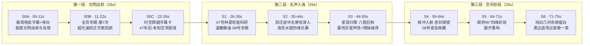

# 《维度之外 · Beyond 3D》序章《迷航》制作规格书（v1.0 初定稿）

> **版本状态**：**初定稿 v1.0**（约 90% 锁定，后续可继续微调台词与镜头细节）  
> **影片形态**：纯电影级实时 3D 过场演出（2.35:1 宽银幕黑边、全自动电影运镜、无需玩家操作、支持按 `Space` 随时平滑跳过）  
> **预计总时长**：**约 75 秒**（9 个电影镜头 `S0A–S6`）  
> **情绪基调**：**孤独而炽热的流浪星舰文明希望 → 壮丽的深空跃迁史诗 → 令人屏息的宇宙死寂与高维敬畏 → 硬核四维奇观震撼 → 留白过渡至第一章**  
> **与第一章的解耦说明**：本项目旧版第一章暂不作为视觉衔接依据，待迁入并打磨 [`migration/chapter1-4d-space/`](../../migration/chapter1-4d-space/)（源自 `zhang-guangfei/4d-space`）的高完成度建模与美术资产后，再与序章尾镜 `S6` 做最终视觉咬合。因此本规格书中 **序章画面完全独立于旧版第一章**。

---

## 一、故事背景与星舰文明设定（致敬《三体III：死神永生》）

- **舰队由来与处境**：离开太阳系后，逃亡星舰舰队失去了母星与归途——**舰队本身，就是人类最后的故乡**。他们背负着文明火种，在浩瀚而暗藏未知凶险的宇宙中漂泊流浪、生存并发展，寻找新的宜居家园；面对难以想象的宇宙不稳定因素，星舰人依然坚韧、克制、勇敢，对迷惘的未来怀抱希望。
- **冬眠与轮值机制**：为了跨越以世纪计的星际荒漠，全舰绝大多数船员处于**低温冬眠状态**，仅极少数科研人员与维护人员按周期轮值苏醒：
  - **07 号（林夏）**：当前苏醒轮值的**空间物理科研员**；
  - **08 号（玩家）**：处于**低温冬眠舱中**，因空间异变触发一级应急协议被唤醒。
- **遭遇四维碎块的真实节奏**：飞船在**第 7 次超光速跃迁巡航途中**，在全员**毫无察觉**的情况下悄然滑入一片正在坍缩的四维空间边界（液态水银光幕）→ **飞船监测系统率先预判到非欧空间曲率异动并发出预警** → 随后异常四维物理现象才正式作用到飞船本体上。

---

## 二、全片三幕电影结构图（9 镜 · 75 秒）

---

## 三、完整剧本与逐秒分镜表（Shot-by-Shot Storyboard）

### 第一段：星舰文明的由来、冬眠与超光速启航（`00s – 26s`）

#### 镜 0A（`00s – 11s`）｜极简电影开场字幕 + 沉稳旁白
- **画面与构图**：纯黑宇宙幕布漂浮着微弱冷白星尘，屏幕中央依次优雅淡入三行极简纤细中文电影字幕：
  1. `离开太阳系后，我们再也没有了归途。`
  2. `没有母星，舰队便是人类最后的故乡。`
  3. `在危机四伏的未知深空里，唯有继续向前。`
- **声景与旁白**（❌ 严禁使用低频飞船巡航嗡鸣）：
  - *配乐*：**清澈空灵的极简钢琴单音 + 柔和温暖的大提琴长弦**。
  - **旁白语音**：*「告别太阳系的那一天，逃亡舰队失去了母星，也失去了归途。茫茫星海里，这支舰队就是人类唯一的家。前方潜伏着难以想象的宇宙变数，但为了替文明找到下一片宜居的星空，我们别无选择——只能带着希望，一直航行下去。」*

#### 镜 0B（`11s – 22s`）｜全员冬眠与第 7 次超光速跃迁特效镜头
- **画面与运镜**：
  - **`11s – 15s`（冬眠长廊快切）**：一排排低温冬眠舱在清脆锁止声中依次降下雾化玻璃、亮起平稳冰蓝生命体征灯；镜头掠过标着 **`08 号`** 的冬眠舱缓缓闭合。
  - **`15s – 22s`（深空外景华丽特效）**：切至浩瀚深空，领航科研舰**「远航者号」**与星舰编队展开曲率推进环，尾部迸发绚丽的**青金色超光速曲率光环与径向星流隧道**；FOV 极速拉宽，整支舰队化作璀璨流光射向无垠宇宙。
- **声景与广播**：
  - *音效*：弦乐渐强蓄能 → 跃迁点火瞬间爆发清亮宏大的**水晶谐波滑音**。
  - **舰桥广播**：*「全员低温冬眠确认，仅保留轮值科研组在线。远航者编队——开启第 7 次深空超光速跃迁。」*

#### 镜 0C（`22s – 26s`）｜时空跨越坐标字幕卡
- **画面**：绚丽跃迁流光沉淀为静谧无垠的深空荒漠，画面淡入宇航等宽时空坐标：
  - **`星舰纪元 47 年 · 距太阳系 412 光年`**
  - **`人马座旋臂外缘 · 未知空洞星域（第 7 次跃迁巡航途中）`**

---

### 第二段：毫无察觉的跨越与高维遗迹苏醒（`26s – 55s`）

#### 镜 1（`26s – 35s`）｜47 年后的静默航行与 07 号林夏的日常科研
- **画面与运镜**：领航舰平稳穿行在柔和青蓝跃迁流光中。镜头贴近舰首弧形全景观测窗：舱内大片冬眠舱沉睡在幽蓝待机灯中（可见 `08 号 · 冬眠中`），唯有科研台前亮着一盏温暖琥珀台灯，**07 号科研员林夏**平静地伏案记录星图数据。
- **声景与台词**：
  - *配乐*：清澈温柔的极简钢琴单音与竖琴泛音。
  - **林夏（07 号 · 平静温柔的日志自语）**：*「第 47 年巡航日志。全舰冬眠体征平稳，距目标星域只剩最后一段跃迁——08 号，等抵达那片新的星空，就叫醒大家。」*

#### 镜 2（`35s – 44s`）｜跃迁途中毫无察觉地滑入液态水银四维光幕
- **画面与运镜**：镜头退回领航舰侧前方。飞船仍在平稳滑行、**全员毫无察觉**；前方虚空悄然横亘着一道在星光折射下泛起微弱**液态水银涟漪的透明四维空间边界**。领航舰无声穿透光幕，舰体接触面荡开一圈极静谧的银白色同心圆几何波纹。
- **预警触发**：整舰没入光幕 2 秒后，舰载监测阵列率先预判到非欧空间曲率异动，舱内指示灯切为冷静的琥珀色预警频闪。
- **声景与播报**：
  - *音效*：钢琴音在穿幕瞬间泛出空灵晶体延音 → 清脆克制的科研预警提示音。
  - **舰载监测系统**：*「预警：跃迁通道前方监测到非欧几里得空间曲率异动……未知高频翘曲边界已接触船体。」*

#### 镜 3（`44s – 55s`）｜星辰归零、八胞巨构苏醒与「墓地」异星声学信号
- **画面与运镜**：预警刚落，跃迁流光凝固消散，**漫天恒星一颗接一颗悄无声息地彻底熄灭**。镜头极速拉远，领航舰微缩成画面下方的一粒银白微尘；正前方无边黑暗中，一座由无数发光立方体递归嵌套而成的**宇宙级四维正八胞体巨构**缓缓展开旋转，洒下冰冷神圣的苍青流金光芒。
- **声景与「墓地」非人类异星语音 + 舰载频谱仪残缺破译**：
  - *音频*：人类配乐抽空，陷入令人屏息的宇宙死寂；巨构深处传来完全非人类的古老高维声学共鸣（脉冲星节拍 + 晶格倒放泛音 + 深海巨鲸式苍茫共振，❌ 绝不说地球话）。
  - *画面下方 UI*：极简透明的**舰载量子频谱仪波形条**随异星声波微微起伏，跳动浮现残缺试探转译：
    > `[未知高维引力波频谱 · 语义解析率 14%]：……干涸……海……新的访客……`

---

### 第三段：四维现象作用船体、空间折纸与留白过渡（`55s – 75s`）

#### 镜 4（`55s – 64s`）｜俯冲扎回科研舱 · 硬核四维「密封穿壁」与 08 号唤醒
- **画面与运镜**：镜头如流星般**极速俯冲、穿透全景观测窗扎回科研舱内部**。
- **硬核四维奇观（100% 符合四维拓扑原理）**：
  - 科研台中央一只**六面完全密封的透明高硼硅实验盒**，在**玻璃完好、盒盖纹丝未动**的情况下，里面的银蓝校准球沿着第四维悄无声息直接**穿壁飘出**，悬浮在盒外半空；
  - 苍青高维光波扫过船舱，金属台面与舱壁短暂呈现**三维内部无遮挡透视**；
  - 弧形全景玻璃浮现精密的**青金色四维正交网格裂纹**，无声碎成数百片**悬浮发光的几何光片，却毫无失压**；
  - 镜头转向后侧亮起紧急绿光的 **`08 号冬眠舱`**——舱门滑开、寒雾散去，无缝切入刚苏醒的 08 号第一人称视角！
- **声景与台词**：
  - **林夏（惊愕看向穿壁飘出的晶球，随即转向唤醒中的 08 号）**：*「密封箱根本没开……它直接从里面穿出来了！08 号，快醒醒——空间正在把船体折进去！」*

#### 镜 5（`64s – 71s`）｜舰桥 90° 四维折纸展开重构
- **画面与运镜**：刚睁开眼的 08 号视野中，深色钛金科研舱的地板、天花板与弧形舱壁沿着发光的青金色 **90° 四维铰链线**，如巨型立体魔方折纸般向四周展开、翻转、拉伸，在极昼光浪与漫天悬浮几何光片中彻底褪去暗色。
- **声景**：精密宏大的巨型几何咬合声 + 竖琴晶体泛音滑升。

#### 镜 6（`71s – 75s`）｜极昼留白与电影黑边退场（独立解耦，不绑定旧版第一章）
- **画面与转场**：空间折叠展开的瞬间，刺目而柔和的极昼纯白几何光浪吞没整个视野（**无多余台词、不绑定旧版第一章场景**），一切轰鸣归于深邃静谧；2.35:1 电影黑边缓缓退场，画面由极昼白光平滑淡入第一章开场（后续待 [`migration/chapter1-4d-space/`](../../migration/chapter1-4d-space/) 迁移打磨完成后，可将尾镜与新版第一章舱内首帧做精准 Match Cut 咬合）。

---

## 四、核心美术与音频硬约束摘要

- **彻底禁绝**：❌ 红丝带、❌ 倒影慢半拍、❌ 飞船低频巡航嗡鸣、❌ 外星文明直接说地球话。
- **音频美学**：清澈极简钢琴单音 + 温暖大提琴长弦 + 水晶跃迁滑音 + 非人类高维脉冲星/鲸歌谐波。
- **渲染标准**：严格遵守 [`quality-spec-v1.md`](quality-spec-v1.md)（全 PBR、6 面 IBL、ACES/Bloom、多层 GPU 粒子、2.35:1 电影黑边、随时 `Space` 跳过、1280×720 及以上零 UI 遮挡）。
